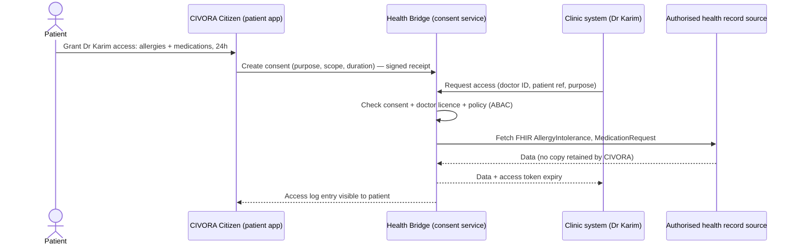

# 7. Citizen User Journeys

Personas are composite and fictional, built from the market evidence in Section 3. All of them must be validated through user research (≥30 interviews and usability tests in the first 90 days, Section 20).

Each journey states what can be **prototyped now with synthetic data** and what **requires authorisation** before it can be real.

## 7.1 Personas

| Persona | Profile | Digital confidence | Key needs |
|---|---|---|---|
| **Amira** (34, Sfax) | Salaried employee, two children, smartphone-first | High | Speed, status visibility, fewer office visits |
| **Hédi** (71, Kairouan) | Retired public servant (CNRPS), diabetic, basic phone | Low | Assisted help, family delegation, health reimbursements |
| **Yassine** (29, Lyon) | Tunisian living in France | High, but far from offices | Remote procedures, consulate appointments, documents in French |
| **Salma** (45, Tunis) | Small business owner (restaurant) | Medium | Pay fees and fines, staff social declarations, licences |
| **Dr Karim** (52, Sousse) | Private-clinic physician | Medium | Patient history with consent, telemedicine scheduling |
| **Nour** (38, municipal civil-status officer) | Civil servant | Medium | Clear queues, fewer incomplete files, fewer phone calls |
| **Bank compliance officer** (B2B) | Digital onboarding lead at a bank | High | BCT-compliant remote onboarding, audit evidence |

## 7.2 Journeys

### J1 — Amira renews her passport (life event: travel)

| Step | Today (pain) | With CIVORA |
|---|---|---|
| Discover | Searches social media; contradictory advice | Asks the Guide in Derja: *"chnowa lazem bech njadded el passeport?"*. Gets the official steps, fees, documents and offices, with sources and a last-verified date |
| Prepare | Misses a document and returns twice | Personal checklist; reminder of the CIN expiry date (user-entered) |
| Book | Queues at the office | Deep-link to the official appointment service. Online appointments are announced by MoI from 2027 [P][S13] |
| Track | Calls the office | Status tracking only if the issuing authority shares status events (authorised integration) |
| After | — | Expiry reminder set for 10 years minus 6 months |

- **Modules:** J, K (if supplied to MoI), I, L.
- **Data:** T3 (Guide); T2 (reminders, user-entered).
- **Prototype now:** Guide, checklist and reminders. **Requires authorisation:** booking and status integration with MoI.

### J2 — Newborn life event (Amira's third child)

1. The birth is declared at the hospital through the MoH's PNDN, and a health ID is assigned automatically [P][S70][S71].
2. The Guide proactively explains the next steps:
   - civil-status registration deadlines
   - CNAM coverage for the newborn
   - family allowance (CNSS)
   - vaccination calendar
3. In a country where the registry is integrated (L3 or future Tunisia): **one bundled request** ("tell us once") creates the civil-status record and propagates to the insurance and allowance services, with parental mandate and consent receipts.

- **Modules:** J, B, F, C, L.
- **Data:** T0/T1.
- **Prototype now:** Guide explanations and the life-event checklist; a synthetic end-to-end bundle demo. **Requires authorisation:** every real data flow (MoI, MoH, CNAM, CNSS).

### J3 — Hédi gets reimbursed by CNAM, with help from his daughter

1. Hédi's daughter (in Tunis) receives a **mandate**, granted at a counter or digitally. The mandate is scoped to "CNAM reimbursements and appointments" and is valid for 12 months.
2. She sees reimbursement status and receives SMS notifications in Arabic for Hédi's claims.
3. Hédi receives simple voice/SMS updates. He can revoke the mandate at the counter or by phone.
4. Every action shows "performed by [daughter] on behalf of Hédi" in his access log.

- **Pain addressed:** delays and no status visibility [P][S62].
- **Modules:** A (delegation), F, K, L.
- **Data:** T1.
- **Prototype now:** mandate model and notifications with synthetic claims. **Requires authorisation:** CNAM status data.

### J4 — Yassine needs a birth extract in French and a consular appointment (diaspora)

1. The Guide (French) explains:
   - the e-Houwiya diaspora enrolment [P][S2]
   - the online birth-extract request via e-Bawaba [P][S15]
   - the remote translation service launched in Aug 2026 [P][S16]
2. Deep-links to the official services. CIVORA never intermediates the official request unless it is authorised.
3. Consulate appointment booking and case tracking, if the MFA/consulate adopts CIVORA Workspace.

- **Modules:** J, K.
- **Data:** T3 / T2.
- **Prototype now:** Guide. **Requires a contract:** consular Workspace (a strong pilot candidate).

### J5 — Salma pays a fee and declares staff contributions

1. The Guide explains CNSS employer obligations and online declaration [P][S63].
2. Fee payment through orchestration with ClicToPay or e-Dinar. A receipt is stored in her wallet.
3. Licence renewal reminders.

- **Modules:** J, E, D.
- **Data:** T1.
- **Prototype now:** simulated payment. **Requires a commercial agreement:** PSP merchant onboarding. **Requires authorisation:** authoritative fee and fine data.

### J6 — Dr Karim sees a new patient's allergies with consent

- **Break-glass variant:** an unconscious patient is brought to the ER. The doctor invokes emergency access with a justification, and only the emergency dataset is shown. The patient and the supervising authority are notified and the access is reviewed afterwards.
- **Legal:** consent for access by another physician is required under the telemedicine framework [P][S48]; INPDP authorisation for health processing [P][S33].
- **Prototype now:** synthetic FHIR data only. **Requires authorisation:** MoH, INPDP and the clinic agreement.

### J7 — Nour processes civil-status requests (civil servant)

1. Queue view: new requests, missing-document flags (pre-checked against the Guide's checklist), SLA timers.
2. She verifies documents, requests corrections (the citizen is notified), approves and schedules pick-up or e-delivery.
3. Her dashboard shows backlog, average processing time and rejection reasons. These feed procedure simplification (a *Dalil* objective [P][S27]).

- **Modules:** K, L.
- **Data:** T1–T2.
- **Prototype now:** full workflow with synthetic cases. **Requires a contract:** a real deployment.

### J8 — A bank onboards a customer remotely (B2B, L1)

1. The customer starts account opening in the bank's app. The bank calls CIVORA Trust.
2. Steps: CIN capture and OCR, then liveness check (licensed vendor), then sanctions/PEP screening, then data-consistency checks, then optional Mobile ID authentication *if authorised* [U], then e-signature of the contract with a TunTrust certificate.
3. CIVORA generates the KYC sheet and evidence pack required by BCT Circular 2025-06 [P][S51]. It is stored in the bank's tenant in Tunisia with a defined retention.
4. Consent receipt to the customer; access log for the bank's auditors.

- **Data:** T1 (T0 transient for liveness; no template retention by CIVORA).
- **Prototype now:** with test identities and a vendor sandbox. **Requires a commercial agreement:** a vendor contract, a bank contract and INPDP declarations.

## 7.3 Cross-journey requirements derived

1. **Deep-link, don't intermediate**, until authorised. The Guide sends citizens to the real official service.
2. **Mandates (delegation)** are first-class: needed in J2, J3 and J4.
3. **Status events** are the most valuable integration, and the most commonly missing.
4. **Assisted channels:** every journey must be completable with a human helper.
5. **Evidence and audit** are products in their own right (J6, J8).
