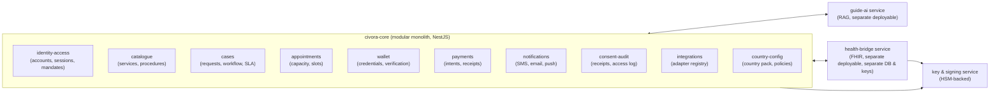
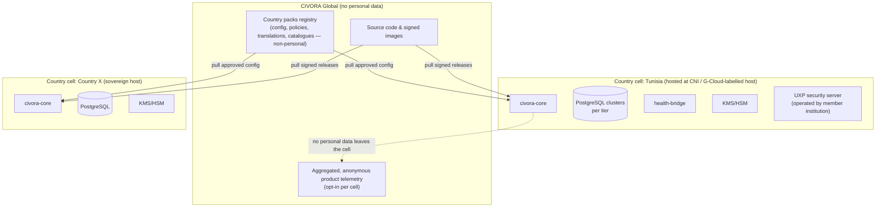
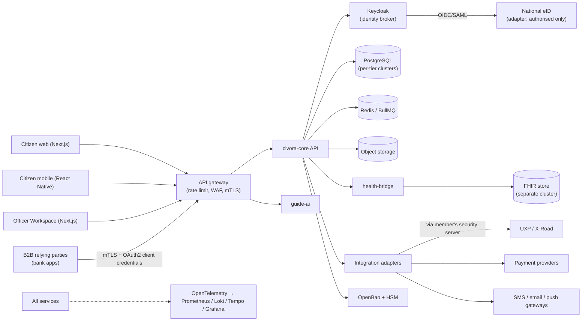

# 8. Technical Architecture

> Status: **proposed architecture for approval.** Nothing below is implemented. Each decision becomes an Architecture Decision Record (ADR) in Phase 2.

## 8.1 Architecture drivers

| Driver | Requirement | Consequence |
|---|---|---|
| Data sovereignty | Personal data stays in-country; public platforms hosted at CNI / sectoral centres / licensed operators in Tunisia [P][S46] | **Country cells**: one isolated deployment per country, deployable on-premises or on local clouds. No dependency on a foreign SaaS for the data plane |
| Sensitivity separation | Health, identity, financial and administrative data have different legal regimes | Separate data stores and keys per tier. Health runs as a separate deployable from day one |
| Deployability by others | Governments (CNI) may operate it themselves | Containers, documented runbooks, no exotic managed services |
| Small team, fast iteration | 6–8 engineers in MVP | **Modular monolith**, one language end to end, boring proven tech |
| Interoperability | UXP/X-Road, OIDC/SAML eIDs, FHIR, W3C VC | Adapter framework; standards-first APIs |
| Multilingual / RTL | AR (MSA + Derja), FR, EN | i18n and RTL built into the design system from the first screen |
| Auditability | Every access attributable and reviewable | Append-only, hash-chained audit as a platform service |

## 8.2 Stack evaluation and recommendation

| Layer | Options considered | Recommendation | Justification |
|---|---|---|---|
| Web frontend | React SPA, **Next.js**, Angular | **Next.js (React, TypeScript)** | SSR for performance on low-end devices and SEO for the public Guide; mature i18n/RTL; large Tunisian talent pool. Use static/edge rendering only for public content; authenticated pages are server-rendered inside the country cell |
| Mobile | **React Native (Expo)**, Flutter, native | **React Native** | One language (TypeScript) across web, mobile and backend for a small team; shared validation and i18n libraries. Flutter gives more consistent rendering but splits the stack. Revisit only if accessibility or performance tests fail |
| Backend | Express, **NestJS**, Fastify, Go, Java/Spring | **NestJS on Node.js LTS, strict TypeScript** | Opinionated modular structure maps to bounded contexts; DI and testing support; OpenAPI generation. Go/Java are viable but add a second language. CPU-heavy work (OCR, ML) goes to separate workers or vendors anyway |
| Database | **PostgreSQL**, MySQL, MongoDB | **PostgreSQL 16+** | Relational integrity for cases and consents; row-level security; JSONB for configurable forms; pgvector for RAG over *public* content; strong backup tooling (pgBackRest) |
| Cache / queues | **Redis**, RabbitMQ, Kafka, NATS | **Redis + BullMQ** (MVP), **transactional outbox in Postgres**; NATS JetStream or Kafka later | Minimal operations for MVP; the outbox guarantees no lost events; the broker can be swapped behind an interface |
| Object storage | S3, **MinIO** / S3-compatible local | **S3-compatible API** (MinIO or the host's object store) | Must run on Tunisian hosting; S3 API keeps portability |
| Identity & access | Custom, **Keycloak**, Ory, Auth0 | **Keycloak** as identity broker and staff IdP | Open source, self-hostable, widely used in government, supports OIDC/SAML brokering, WebAuthn/passkeys, fine-grained clients. No foreign SaaS for identity |
| Authorisation | Hand-rolled, **OPA**, Cedar, OpenFGA | **Policy engine (OPA or Cedar)** for ABAC + app-level RBAC | Policies as versioned, testable artefacts; per-country policy packs |
| Health data | Custom tables, **HAPI FHIR**, Medplum | **FHIR server** (Medplum, TypeScript, or HAPI FHIR, Java) in a separate deployable | Standards compliance; do not invent clinical data models. Choose after Phase 7 evaluation |
| API gateway | NGINX, **Apache APISIX**, Kong | NGINX ingress (MVP) → **APISIX/Kong** at pilot | Rate limiting, mTLS, API keys for B2B, WAF integration |
| Observability | SaaS APM, **OpenTelemetry + Prometheus/Grafana/Loki/Tempo** | **Self-hosted OpenTelemetry stack**; self-hosted error tracking (Sentry self-hosted or GlitchTip) | Logs and traces may contain metadata about citizens and must stay in-country |
| Secrets & keys | Env vars, **Vault/OpenBao**, cloud KMS | **OpenBao/Vault** + **HSM** for signing keys (production) | Envelope encryption, per-tenant keys, rotation; HSM for credential issuance and seals |
| Infrastructure | VMs, **Kubernetes (k3s/RKE2)**, OpenShift | **Containers on Kubernetes** (k3s for small cells), IaC with Terraform/OpenTofu + Ansible; Helm charts | Portable across CNI, labelled clouds and foreign sovereign clouds |
| CI/CD | **GitHub Actions**, GitLab CI | GitHub Actions for build/test; **pull-based deploy (Argo CD/Flux)** into cells | Cells pull signed images; no CI system holds production credentials for government cells |
| AI | API LLMs, self-hosted open-weight models | **Model gateway** with per-country routing policy (8.6) | No personal data to foreign APIs; swap models without code changes |

## 8.3 Modular monolith — module map

One deployable (`civora-core`) with strictly separated modules. The rules:
- No cross-module database access.
- Communication only through published interfaces or domain events.
- One schema per module.

**Separately deployed from day one, and why:**
- **health-bridge** has a different legal and compliance boundary (T0 data, telemedicine hosting rules, separate access controls).
- **guide-ai** has different scaling (GPU/LLM calls), a different failure mode, and no personal data in v1.
- The **key & signing service** follows the HSM boundary and least privilege.

## 8.4 Global core + country cells

**A country pack** contains:
- Languages and terminology.
- Legal policy set: retention rules, consent texts, lawful bases, age of majority, data-subject rights workflows.
- Identity profile: which eID, assurance mapping, identifier formats.
- Service catalogue and workflow templates.
- Payment providers.
- Hosting profile.
- Authorisation policies (OPA/Cedar bundles).
- Notification channels.
- Calendar/holidays.
- Branding (white-label).

**Isolation guarantees:**
- Separate databases, keys, secrets and backups per cell.
- Cells cannot call each other.
- Cross-border support access is disabled by default. Support works through in-country staff or "break-glass with customer approval", and is logged.

**Multi-tenancy inside a cell:** an institution is a *tenant*.
- Logical isolation uses `tenant_id` and PostgreSQL Row-Level Security.
- T0/T1 data for large institutions can get dedicated databases.

## 8.5 Container view (single cell)

## 8.6 AI architecture (CIVORA Guide)

**Pipeline:**
1. **Corpus curation.** Official sources only: Dalil, ministry pages, JORT texts, official FAQs. Each document records:
   - source URL, publisher, retrieval date
   - legal effective date
   - checksum
   - human reviewer
   - licence/permission status
2. **Ingestion.** Normalise, chunk by procedure step, and embed (pgvector). Arabic-aware text processing with ICU normalisation, diacritics handling and Arabizi transliteration for queries.
3. **Query handling:**
   - Language and dialect detection (MSA / Derja-Arabic / Arabizi / FR / EN).
   - **PII redaction before any model call.**
   - Intent classification.
   - Retrieval (hybrid: BM25 + vectors).
   - Re-ranking.
4. **Generation.** The model is constrained to answer only from retrieved passages and must cite them. If retrieval confidence is below threshold, it refuses and offers alternatives (official phone line, office).
5. **Post-checks:**
   - Citation verification: every claim maps to a passage.
   - Forbidden-topic filter: legal advice, eligibility decisions, medical advice.
   - Disclaimer injection.
6. **Feedback loop.** Thumbs up/down with reason; human review queue; corpus correction workflow.

**Model hosting policy (per country pack):**

| Data in prompt | Allowed model location |
|---|---|
| Public content + anonymised query (v1) | API model abroad **allowed only if** the contracting institution approves and no personal data is present. Confirm with counsel whether INPDP transfer formalities apply |
| Any personal data (later versions) | **In-country only**: self-hosted open-weight model on the cell's GPU, or an in-country provider. Tunisian GPU hosting availability to be assessed [U] |

**Evaluation** (gate for every release):
- A **golden set** of ≥500 questions per language: MSA, Derja-Arabic, Arabizi, FR, EN.
- Factual accuracy against sources (target ≥95% on the golden set).
- Citation precision.
- Refusal correctness.
- Toxicity and bias checks.
- Latency on 3G.
- Derja and Arabizi get dedicated test sets, because LLM competence there is uneven [V][S111].

**Never:** decisions on eligibility or rights, legal advice, collecting identity numbers in chat, or training on citizens' conversations without explicit opt-in and a lawful basis.

## 8.7 Integration architecture

- **Adapter framework.** Every external system sits behind an interface (`IdentityProvider`, `RegistryQuery`, `StatusFeed`, `PaymentProvider`, `MessagingChannel`, `CredentialIssuer`). Each adapter has three variants:
  - `simulated` for development and demos
  - `sandbox`
  - `production`, enabled only when the integration register says `AUTHORIZED`
- **UXP/X-Road.**
  - CIVORA never runs its own security server on behalf of the state.
  - In a deployment for member institution M, M's security server signs and logs requests.
  - CIVORA's adapter speaks the UXP message protocol through it.
  - Each service call carries purpose, legal basis reference and end-user reference for audit.
- **eID.** OIDC/SAML brokering via Keycloak; pairwise subject identifiers per relying party to prevent cross-service tracking.
- **Resilience.** Timeouts, retries with jitter, circuit breakers, idempotency keys, dead-letter queues. "Degraded mode" UX: the citizen sees that the source registry is unavailable, never stale data presented as current.
- **Integration logging.** Each call is logged with correlation ID, adapter, purpose, outcome and latency. Payloads are not logged unless policy allows.

## 8.8 Events and asynchronous processing

- **Transactional outbox** in each module schema. A relay publishes to the queue, which gives at-least-once delivery. Consumers are idempotent.
- **Domain events** (examples):
  - `CaseSubmitted`, `CaseStatusChanged`
  - `AppointmentBooked`
  - `ConsentGranted`, `ConsentRevoked`
  - `CredentialIssued`, `CredentialRevoked`
  - `PaymentSucceeded`
  - `MandateGranted`
- Events carry **references, not personal payloads**, where possible.
- Scheduled jobs (BullMQ): reminders, SLA escalations, retention purges, credential status list refresh.

## 8.9 API standards

- REST/JSON, **OpenAPI 3.1** as contract-first source of truth; URL versioning (`/v1/...`).
- OAuth 2.1:
  - Authorization Code + PKCE for apps.
  - Client credentials + **mTLS** for B2B.
  - DPoP for high-assurance clients (later).
- Idempotency keys on all POSTs that create resources; cursor pagination; RFC 9457 problem details for errors.
- `Accept-Language` drives localisation; all user-facing strings come from translation catalogues.
- Webhooks are signed (HMAC with rotating secrets), with replay protection.
- Indicative endpoint families by phase are given in Section 19.

## 8.10 Infrastructure, environments, operations

| Environment | Purpose | Data | Hosting |
|---|---|---|---|
| `dev` | Engineering | Synthetic only | Any cloud (no personal data) |
| `staging` | Integration, security testing, demos | Synthetic only | Any cloud, or the target host |
| `pilot-<country>` | Authorised pilot | Real (authorised scope) | In-country, labelled host |
| `prod-<country>` | Production | Real | In-country, labelled host, two sites |

- **Backups:**
  - PostgreSQL PITR (WAL archiving, pgBackRest), encrypted, in-country secondary site.
  - **Restore tested monthly**, with results recorded.
- **DR targets** (pilot): RPO ≤ 15 min, RTO ≤ 4 h. Production targets are negotiated per SLA.
- **Monitoring:** SLOs per journey (e.g. "submit request" availability 99.5% pilot / 99.9% production), alerting, on-call rota, status page.
- **Supply chain:**
  - Signed container images (cosign).
  - SBOM per release.
  - Dependency scanning.
  - Reproducible builds targeted (SLSA level 2 → 3).

**No hyperscaler region in Tunisia was identified during this research** [U — verify]. Tunisian deployments therefore assume local labelled hosts (G-Cloud/N-Cloud [P][S43]) or CNI.

## 8.11 Migration path from modular monolith to services

Extract a module into its own service only when one of these triggers is met, and document it as an ADR:
1. Independent scaling needs that are measured, not predicted (e.g. notifications at national scale).
2. A distinct compliance or hosting boundary (already applied to health and AI).
3. Team topology: more than ~3 stream-aligned teams contending on one deployable.
4. A different availability tier is required, e.g. verification APIs for banks at 99.95%.

Likely first extractions: `notifications`, `trust/verification` (B2B SLAs), `appointments` (peak loads).

Because boundaries, schemas and events are separated from day one, extraction means moving code and pointing the outbox to a broker. It does not require a rewrite.

## 8.12 Proposed ADR backlog (Phase 2)

| ADR | Decision |
|---|---|
| 001 | Modular monolith with separately deployed health-bridge, guide-ai, key service |
| 002 | TypeScript end-to-end (NestJS, Next.js, React Native), strict mode |
| 003 | PostgreSQL per-tier clusters, schema-per-module, RLS for tenants |
| 004 | Country-cell deployment model; no cross-cell data flows |
| 005 | Keycloak as identity broker; passkeys first; SMS OTP fallback only |
| 006 | OPA or Cedar for ABAC (evaluate both in Phase 2) |
| 007 | FHIR server choice (Medplum vs HAPI) — decided in Phase 7 |
| 008 | Outbox + BullMQ; broker abstraction |
| 009 | W3C VC 2.0 / SD-JWT VC / OpenID4VCI/VP; ISO mDL for licences |
| 010 | RAG-only assistant with citation enforcement; model gateway with location policy |
| 011 | Self-hosted observability stack; no personal data in logs |
| 012 | OpenBao/Vault + HSM; envelope encryption; per-tenant keys |
| 013 | Kubernetes (k3s/RKE2), Helm, OpenTofu, Argo CD pull deployments |
| 014 | Accessibility (WCAG 2.2 AA) and RTL as release gates |
