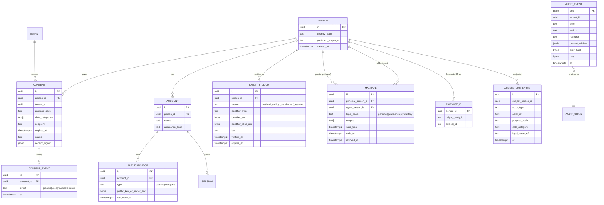
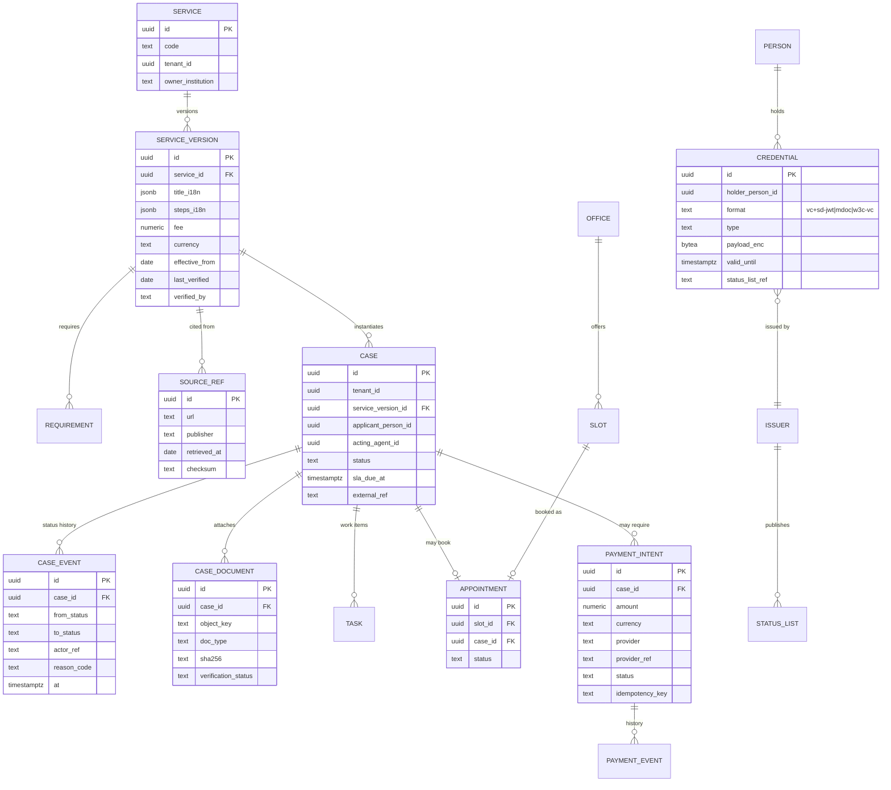

# 9. Database Architecture

> Logical design for approval. The physical DDL is produced in Phase 2/3 and reviewed by the security lead and DPO.

## 9.1 Principles

1. **Pointer, not copy.** Store references to authoritative records (registry, document number hash, FHIR resource URL) rather than the records themselves, unless a copy has a lawful basis, a purpose and a retention period.
2. **Separate by sensitivity tier.** Different clusters, credentials, keys and backup policies for T0, T1, T2 and T3 data (tiers defined in Section 10).
3. **Internal identifiers are meaningless.** UUIDv7 primary keys. National identifiers (CIN, IUC, passport no.) are never primary keys:
   - They are stored encrypted, with an HMAC "blind index" for exact-match lookup.
   - They are only stored where the service needs them.
4. **Unlinkability across relying parties.** Pairwise pseudonymous subject IDs per institution or relying party.
5. **Tenant isolation.** `tenant_id` on every tenant-scoped row, enforced by PostgreSQL Row-Level Security, plus application checks.
6. **Everything time-bound.** Each table has a retention class. Purge jobs are tested and audited.
7. **Append-only where trust matters.** Audit, consent receipts and status histories are never updated in place.

## 9.2 Physical layout per country cell

| Cluster | Tier | Contents | Notes |
|---|---|---|---|
| `pg-public` | T3 | Service catalogue, procedures, Guide corpus + embeddings (pgvector), translations | No personal data; replicable to edge for performance |
| `pg-core` | T1/T2 | Schemas: `iam`, `cases`, `appointments`, `wallet`, `payments`, `notifications`, `integrations`, `config` | RLS per tenant; field-level encryption for T1 columns |
| `pg-consent-audit` | T1 (metadata) | `consent`, `audit` | Append-only roles; hash chain; WORM-style backups |
| `fhir-store` | T0 | FHIR resources (health-bridge only) | Separate network segment, credentials, keys; no direct access from core |
| `redis` | T2 (transient) | Sessions, rate limits, queues | No T0/T1 payloads; encryption in transit; short TTLs |
| `object-store` | T1/T2 | Uploaded documents, generated PDFs, credential backups (encrypted) | Per-tenant buckets; server-side + envelope encryption; object lock for evidence |

## 9.3 Core entity model — identity, mandates, consent, audit

## 9.4 Core entity model — catalogue, cases, appointments, wallet, payments

## 9.5 Health data (T0)

- Stored only in the **FHIR store** behind health-bridge, using standard FHIR R4 resources: Patient, Practitioner, Organization, Encounter, Condition, Observation, DiagnosticReport, ImagingStudy (references only; images stay in the source PACS), MedicationRequest, MedicationStatement, AllergyIntolerance, Immunization, Coverage, Consent, AuditEvent, Provenance.
- Terminologies per country pack: ICD-10/ICD-11, LOINC, ATC. SNOMED CT requires a licence (country membership) [U for Tunisia].
- In "bridge" mode (preferred), the FHIR store holds **only consent, access-grant and cache records with short TTL**. Clinical data is fetched from the authoritative source on demand.
- Retention follows national medical-record rules. Telemedicine data must be kept ≥10 years in Tunisia [P][S48], which applies when CIVORA operates an *authorised* telemedicine platform.

## 9.6 Identifiers and field-level encryption

| Data | Storage | Lookup |
|---|---|---|
| National ID numbers (CIN, IUC, passport) | AES-256-GCM, per-tenant data key (envelope, KMS) | HMAC-SHA-256 blind index with a cell-specific secret |
| Phone, email | Encrypted | Blind index for login/recovery |
| Names, date of birth | Encrypted for T1 contexts; plaintext only in display caches with short TTL | Not searchable except by authorised officers via exact match |
| Documents (uploads) | Object storage, envelope-encrypted, per-tenant buckets | By case reference |
| Biometrics | **Not stored by CIVORA.** Liveness/face-match results only (score, vendor reference, timestamp) | — |

## 9.7 Audit and access log design

- **Two layers:**
  - `audit_event`: system-wide, security-oriented, hash-chained.
  - `access_log_entry`: citizen-facing ("who accessed my data, when, why").
- Hash chain: `hash = SHA-256(prev_hash || canonical(event))`. The chain head is **anchored daily**: signed by the HSM and stored off-cluster, optionally timestamped by a qualified time-stamping service.
- Partitioned by month; write-only DB role for the application; read via a dedicated audit service.
- Audit records contain references and purpose codes, **never payload contents**.

## 9.8 Retention schedule (defaults; overridden by country pack and contracts)

| Data class | Default retention | Basis |
|---|---|---|
| Guide conversations (no account) | 30 days, then aggregated statistics only | Minimisation [A] |
| Guide conversations (opt-in history) | Until user deletes, max 12 months | Consent |
| Cases & case events | Per institution's archival rules (typically years) | Contract / public archives law [A — verify] |
| Uploaded documents | Until case closure + institution-defined period | Contract |
| KYC evidence (B2B) | As required by BCT / AML rules for the client bank | Client's legal obligation [P][S51] |
| Consent receipts & history | Life of consent + 5 years [A] | Accountability |
| Audit events | ≥ 5 years [A]; longer if regulator requires | Security / accountability |
| Sessions, OTPs | Minutes to days | Security |
| Telemedicine records | ≥ 10 years | Decree 2022-318 [P][S48] |

## 9.9 Backup, recovery and integrity

- pgBackRest full weekly, differential daily, WAL continuous. Encrypted with keys separate from production keys. Second in-country site.
- **Monthly restore drill** into an isolated environment, with checksum comparison and an application smoke test. Results recorded in the integration/ops register. A backup is only "verified" once restored.
- Object storage versioning; object lock on evidence buckets.

## 9.10 Schema governance

- Migrations are versioned, forward-only and reviewed by two engineers, plus the DPO for any new personal-data field.
- A **data inventory** is generated from schema annotations (`@pii`, `@tier`, `@retention`). It feeds INPDP declarations and Records of Processing Activities (RoPA).
- Analytics never run against production personal data. Aggregated, de-identified extracts (k-anonymity ≥ 10 [A]) go into a separate analytics store only when needed.
