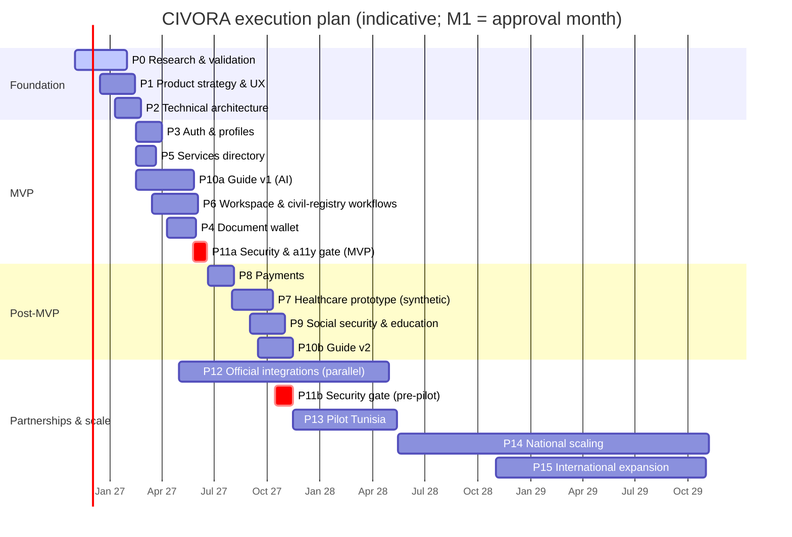

# 19. Detailed Development Roadmap (Phases 0–15)

## 19.1 Recommended re-sequencing (founder decision D8)

> **SUPERSEDED (18 Nov 2026).** The founder's Phase 1 directive (§13) requires the original 15-phase order to stay unchanged; phases must not be renamed, removed, reordered or replaced. The execution order below and the Gantt chart are kept for traceability only. The canonical order is Phase 0 → 15. Phase 1 decision **P1-D4** proposes a first-product track with light passes for Phases 7–10 instead ([../phase-1/13-mvp-scope-and-specification.md](../phase-1/13-mvp-scope-and-specification.md) §13.5). The per-phase content below (objectives, deliverables, endpoints, budgets) remains valid as phase scope.

The brief's phase numbering is kept for traceability, but the **execution order changes**:

| Change | Reason |
|---|---|
| **Phase 10 (AI assistant) moves up** to run with Phases 3 and 5 | Lowest legal barrier (public data), highest demo value, and the lead MVP module |
| **Phase 5 (services directory) precedes Phase 4 (wallet)** | The catalogue feeds the Guide, Workspace and the wallet's renewal deep-links |
| **Phase 11 (security) becomes continuous**, plus formal verification gates before MVP demo and before pilot | Security cannot be a late phase |
| **Phase 7 (healthcare) moves after payments** and remains synthetic until authorised | Highest legal barrier; national MoH programme already underway |
| **Phase 12 (official integrations) runs as a parallel partnership track from ~M6** | It is driven by agreements, not engineering |

**Execution timeline (Moderate staffing; Lean ≈ ×1.5). Week 0 = founder approval of Phase 0.**

*Dates are placeholders relative to an assumed approval in late 2026; they shift with the approval date and funding.*

**Budgets** below are indicative [A]. They are the share of team and external cost attributable to each phase. Parallel phases share the same team, so **phase budgets are not additive beyond the scenario totals in Section 15.**

---

## Phase 0 — Research and Feasibility *(this document)*

- **Objectives:** establish feasibility, positioning, legal map, architecture direction, financial scenarios, decisions.
- **Deliverables:** this 20-section report; decision register; integration register; 90-day plan.
- **Architecture / Features / DB / API:** none.
- **Dependencies:** founder review.
- **Security requirements:** no personal data collected.
- **Testing:** validation through the 90-day discovery programme (Section 20).
- **Acceptance criteria:** founder decisions D1–D10 recorded; legal questions commissioned.
- **Time:** desk research complete; validation 12 weeks.
- **Risks:** desk research gaps ([P]/[U] items); mitigated by interviews and counsel.
- **Budget:** ~15–40k TND for counsel, travel and research incentives [A].

## Phase 1 — Product Strategy and UX/UI

- **Objectives:** validated personas and journeys; brand and design system; clickable prototypes; proposal documents.
- **Deliverables:**
  - research report (≥ 30 citizen interviews, ≥ 10 civil servants, ≥ 10 B2B)
  - service blueprints for 5 journeys
  - **CIVORA design system v1**: tokens, RTL/LTR components, Arabic/Latin typography pairing, accessibility specs, motion guidelines
  - visual identity
  - clickable prototypes (web + mobile)
  - government proposal, executive presentation, pilot proposal template, partnership one-pager (Section 14.9)
  - Citizen Data Charter v1
- **Architecture:** information architecture; content model for catalogue; UX writing guidelines in AR/FR/EN/Derja.
- **Features:** none in production.
- **Database changes:** none.
- **API endpoints:** none.
- **Dependencies:** P0 approval; brand/trademark clearance.
- **Security requirements:** research data handled under consent; anonymised notes; no recordings stored beyond 90 days.
- **Testing:** prototype usability tests (n ≥ 20; ≥ 5 aged 60+; ≥ 3 diaspora; ≥ 2 users with disabilities).
- **Acceptance criteria:** SUS ≥ 70 on prototypes; top-10 pain points evidenced; design system passes WCAG 2.2 AA contrast/target-size checks in both directions.
- **Time:** 8 weeks.
- **Risks:** brand conflicts; research bias toward urban users (mitigate by recruiting in ≥ 4 governorates).
- **Budget:** 150–250k TND.

## Phase 2 — Technical Architecture

- **Objectives:** turn Section 8 into approved ADRs and a working skeleton.
- **Deliverables:**
  - ADR-001..014
  - full STRIDE threat model
  - data inventory and classification
  - repository structure (monorepo: apps/web, apps/mobile, apps/workspace, services/core, services/guide, services/health-bridge, packages/*)
  - CI/CD pipeline with security gates
  - IaC for dev/staging cell
  - synthetic data generator (TN country pack v0)
  - coding standards
- **Architecture:** modular monolith skeleton; Keycloak; PostgreSQL clusters; Redis; object storage; observability stack; OPA/Cedar evaluation spike.
- **Features:** health-check endpoints; feature-flag framework; i18n framework with RTL.
- **Database changes:** base schemas `iam`, `config`, `audit` (empty); migration tooling.
- **API endpoints:** `GET /health`, `GET /v1/meta/locales`, OpenAPI pipeline.
- **Dependencies:** P1 IA outputs (partially).
- **Security requirements:** secrets management; signed builds; SBOM; branch protection; 2-reviewer rule.
- **Testing:** pipeline runs unit/integration test scaffolds; IaC scanning; a deploy-from-scratch test.
- **Acceptance criteria:** staging cell reproducible from IaC in < 2 h; all ADRs approved; threat model reviewed by external security adviser.
- **Time:** 6 weeks.
- **Risks:** over-engineering (mitigation: time-boxed spikes, ADR scope discipline).
- **Budget:** 100–150k TND.

## Phase 3 — Authentication and Citizen Profiles

- **Objectives:** secure accounts, sessions, assurance levels, mandates, eID brokering (simulated).
- **Deliverables:** citizen and officer authentication; profile; mandates; simulated national-eID adapter; account recovery design.
- **Architecture:** Keycloak realms per cell (citizens, staff); OIDC to apps; pairwise subject IDs; step-up flows.
- **Features:**
  - passkeys, TOTP, SMS fallback
  - device management
  - language preference
  - accessibility preferences
  - mandates (create/accept/revoke, scopes, expiry)
  - "acting on behalf of" UI
- **Database changes:** `iam.person`, `iam.account`, `iam.authenticator` (via Keycloak + mirror), `iam.identity_claim`, `iam.mandate`, `iam.pairwise_id`.
- **API endpoints:**
  - OIDC endpoints (Keycloak)
  - `GET/PATCH /v1/me`
  - `GET /v1/me/sessions`, `DELETE /v1/me/sessions/{id}`
  - `GET/POST/DELETE /v1/me/authenticators`
  - `POST /v1/mandates`, `GET /v1/mandates`, `POST /v1/mandates/{id}:accept`, `POST /v1/mandates/{id}:revoke`
  - `POST /v1/identity/links` (eID link, simulated)
- **Dependencies:** P2.
- **Security requirements:**
  - ASVS L3 for authentication
  - rate limits
  - credential-stuffing protection
  - recovery requires re-proofing
  - officer accounts require FIDO2 keys
- **Testing:** unit + integration; auth flow E2E (Playwright, Detox); negative tests (session fixation, CSRF, token replay); mandate-scope authorisation tests.
- **Acceptance criteria:** all auth flows pass E2E in AR/FR/EN; no high findings in internal security review; mandate actions logged and visible to principal.
- **Time:** 6 weeks.
- **Risks:** SMS reliance; usability of passkeys for elderly users (mitigate: assisted flows).
- **Budget:** 150–220k TND.

## Phase 4 — Digital Documents Wallet

- **Objectives:** verifiable credential issuance, holding, presentation and verification (synthetic credentials).
- **Deliverables:** issuer service (demo issuers); holder wallet in mobile app; verifier web app and API; status lists; expiry reminders.
- **Architecture:** OpenID4VCI / OpenID4VP; SD-JWT VC; W3C VC 2.0 data model; ISO mDL support planned (licences); keys in HSM (dev: SoftHSM).
- **Features:** add credential via offer QR; selective disclosure; QR presentation; offline verification with grace policy; revocation; renewal deep-links to official service.
- **Database changes:** `wallet.issuer`, `wallet.credential_type`, `wallet.credential` (encrypted backup metadata), `wallet.status_list`, `wallet.presentation_log`.
- **API endpoints:**
  - `POST /v1/issuers/{id}/credential-offers`
  - `POST /v1/oid4vci/token`, `POST /v1/oid4vci/credential`
  - `GET /v1/wallet/credentials`
  - `POST /v1/oid4vp/requests`, `POST /v1/oid4vp/responses`
  - `POST /v1/verify`
  - `GET /v1/status-lists/{id}`
- **Dependencies:** P3; P5 (renewal deep-links).
- **Security requirements:** holder binding (device keys); replay protection (nonce); issuer key ceremonies; no PII in QR beyond disclosed claims.
- **Testing:** conformance tests against OpenID4VC test suites where available; interoperability with at least one external wallet/verifier; fuzzing of verifier inputs.
- **Acceptance criteria:** issue → hold → present → verify → revoke works end-to-end on synthetic credentials; verifier rejects revoked/expired/tampered credentials 100% in test suite.
- **Time:** 7 weeks.
- **Risks:** standards churn (mitigate by following EUDI reference implementations [V][S103]).
- **Budget:** 120–180k TND.

## Phase 5 — Government Services Directory

- **Objectives:** the authoritative-sourced service catalogue that powers Guide, Workspace and Citizen app.
- **Deliverables:** catalogue data model; editorial back office with four-eyes approval; public catalogue pages (SEO); search; ≥ 60 Tunisian procedures curated with citations.
- **Architecture:** `pg-public` cluster; static generation for public pages; search (Postgres FTS + Arabic normalisation; OpenSearch later).
- **Features:** service pages (steps, documents, fees, offices, hours, sources, last verified); office locator; change history; "report an error".
- **Database changes:** `catalogue.service`, `catalogue.service_version`, `catalogue.requirement`, `catalogue.source_ref`, `catalogue.office`, `catalogue.editorial_review`.
- **API endpoints:**
  - `GET /v1/services`, `GET /v1/services/{code}`, `GET /v1/services/{code}/versions/{v}`
  - `GET /v1/offices`
  - `POST /v1/admin/services`, `PUT /v1/admin/services/{id}/versions/{v}`, `POST /v1/admin/services/{id}/versions/{v}:approve`
  - `POST /v1/feedback/content-errors`
- **Dependencies:** P2; content team; source permissions (X-04/X-06 in Section 12).
- **Security requirements:** editorial RBAC; signed content versions; integrity monitoring.
- **Testing:** content QA checklist; link checking; accessibility; translation review by native legal-language editors.
- **Acceptance criteria:** 60 procedures published with 100% citation coverage; median "last verified" age < 90 days.
- **Time:** 5 weeks (+ continuous curation).
- **Risks:** content accuracy and staleness (mitigate: verification cadence, error reports).
- **Budget:** 80–120k TND (+ ongoing content ~4–8k TND/month [A]).

## Phase 6 — Civil Registry Workflows (Workspace v1)

- **Objectives:** request intake, case management and appointments, demonstrated on civil-status and consular-type services.
- **Deliverables:** Workspace web app (officers); citizen request flow; configurable case types; appointments with capacity; notifications; dashboards.
- **Architecture:** `cases`, `appointments`, `notifications` modules; workflow engine (state machine per case type, configured in country pack); outbox events.
- **Features:**
  - intake forms (JSON-schema driven)
  - document upload and checklist
  - assignment and queues
  - SLA timers and escalation
  - request-for-correction loop
  - approval/rejection with reason codes
  - appointment booking/rescheduling
  - SMS/email/push notifications (simulated providers)
  - officer and supervisor dashboards
- **Database changes:** `cases.case`, `cases.case_event`, `cases.case_document`, `cases.task`, `appointments.office_calendar`, `appointments.slot`, `appointments.appointment`, `notifications.message`, `notifications.template`.
- **API endpoints:**
  - `POST /v1/cases`, `GET /v1/cases/{id}`, `POST /v1/cases/{id}/documents`, `POST /v1/cases/{id}/transitions`
  - `GET /v1/workspace/queues`, `POST /v1/workspace/cases/{id}:assign`
  - `GET /v1/offices/{id}/slots`, `POST /v1/appointments`, `PATCH /v1/appointments/{id}`, `DELETE /v1/appointments/{id}`
  - `GET /v1/me/cases`
- **Dependencies:** P3, P5.
- **Security requirements:** tenant RLS; ABAC (office/jurisdiction/assignment); object-level authorisation tests; malware scanning of uploads; audit on every transition.
- **Testing:** workflow unit tests; E2E journeys J1/J4/J7 (Section 7); load test (e.g. 200 concurrent officers, 5,000 submissions/hour per cell [A]).
- **Acceptance criteria:** three case types configurable without code; SLA escalations fire correctly; citizen sees status changes within 1 minute.
- **Time:** 10 weeks.
- **Risks:** institution-specific variation (mitigate: configuration over customisation).
- **Budget:** 200–300k TND.

## Phase 7 — Healthcare Prototype (synthetic data only)

- **Objectives:** demonstrate consent-based, auditable health-data access and emergency access without holding a national record.
- **Deliverables:** health-bridge service; FHIR server (selected via ADR-007); consent and access-grant flows; break-glass flow; patient access log; clinic demo app; DPIA template.
- **Architecture:** separate deployable, separate DB cluster, keys and network segment; FHIR R4; SMART-on-FHIR style authorisation for clinic apps.
- **Features:** patient consent management; provider access requests; emergency dataset; telemedicine appointment scheduling (no video platform built; integrate a vendor later).
- **Database changes:** FHIR store (Consent, AuditEvent, Provenance, minimal clinical resources with synthetic data); `health.access_grant`, `health.break_glass_event`.
- **API endpoints:**
  - `POST /v1/health/consents`, `GET /v1/health/consents`, `POST /v1/health/consents/{id}:revoke`
  - `POST /v1/health/access-requests`, `POST /v1/health/emergency-access`
  - `GET /v1/health/access-log`
  - FHIR proxy `/fhir/R4/{resource}` (scoped tokens)
- **Dependencies:** P3, P11 controls; legal opinion on health (counsel Q1d, Q9).
- **Security requirements:** T0 controls (Section 10.1); break-glass review; no export; anomaly detection; strict logging.
- **Testing:** FHIR conformance (validator); authorisation matrix tests; break-glass audits; privacy review.
- **Acceptance criteria:** journey J6 works end-to-end on synthetic data; 100% of accesses visible to patient; no clinical data persisted in core.
- **Time:** 10 weeks.
- **Risks:** misinterpretation as a health product in production (clear labelling); scope creep.
- **Budget:** 200–300k TND.

## Phase 8 — Payments and Financial Services

- **Objectives:** payment orchestration through licensed providers; receipts; reconciliation.
- **Deliverables:** payment-intent service; provider adapters (sandbox: card gateway, e-Dinar/D17 if sandbox available [U], PSP); receipts as credentials; reconciliation reports.
- **Architecture:** `payments` module; provider adapters; webhook ingestion with signature verification; idempotency.
- **Features:** pay a case fee; receipts; refunds workflow (institution-initiated); payment status in case timeline.
- **Database changes:** `payments.payment_intent`, `payments.payment_event`, `payments.receipt`, `payments.reconciliation_batch`.
- **API endpoints:**
  - `POST /v1/payment-intents`, `GET /v1/payment-intents/{id}`
  - `POST /v1/webhooks/payments/{provider}`
  - `GET /v1/receipts/{id}`
  - `GET /v1/admin/reconciliation`
- **Dependencies:** P6; PSP sandbox agreements (F-01..F-03).
- **Security requirements:** never store card data (PCI scope stays with PSP); webhook signing; amount integrity checks; fraud alerts.
- **Testing:** sandbox E2E; failure/timeout/duplicate webhook tests; reconciliation tests.
- **Acceptance criteria:** zero double-charges in chaos tests; reconciliation matches 100% on test datasets.
- **Time:** 6 weeks.
- **Risks:** provider sandbox availability; merchant onboarding delays.
- **Budget:** 80–120k TND.

## Phase 9 — Social Security and Education

- **Objectives:** status-tracking patterns for social funds; verifiable diplomas for institutions.
- **Deliverables:** social-security status adapter pattern (simulated); reimbursement tracking UX (J3); diploma issuer portal for universities; employer verification portal.
- **Architecture:** `StatusFeed` adapters; wallet issuer profiles for education.
- **Features:** claim status timeline; notifications; mandate-aware views; diploma issuance in bulk; verification by QR or link.
- **Database changes:** `integrations.status_subscription`; `wallet.issuer_profile` for education; `cases` templates for attestations.
- **API endpoints:**
  - `GET /v1/benefits/claims` (adapter-backed)
  - `POST /v1/issuers/{id}/credentials:batch`
  - `GET /v1/verify/{credentialId}`
- **Dependencies:** P4, P6; at least one private university partner for a pilot (E-01).
- **Security requirements:** minors' data protections (parental mandate); issuer authentication.
- **Testing:** E2E J3; diploma batch tests; verification tests.
- **Acceptance criteria:** a university can issue 1,000 synthetic diplomas in < 10 minutes; verification works offline/online.
- **Time:** 8 weeks.
- **Risks:** low institutional readiness.
- **Budget:** 150–220k TND.

## Phase 10 — AI Government Assistant (CIVORA Guide)

*Executed in two steps: **10a** in the MVP (public content only) and **10b** after MVP (opt-in personalisation).*

- **Objectives:** a reliable multilingual assistant that cites official sources and never decides.
- **Deliverables:**
  - **10a:** corpus pipeline; retrieval; model gateway; guardrails; evaluation harness and golden sets; web widget + app integration; admin console.
  - **10b:** opt-in history; explanation of official notices with local PII redaction; voice (pilot); hand-off to human agents (call-centre console).
- **Architecture:** separate `guide-ai` service; pgvector in `pg-public`; model gateway with location policy (Section 8.6).
- **Features:** Q&A with citations; procedure walkthroughs; deep-links; refusal and escalation; feedback.
- **Database changes:** `guide.source`, `guide.chunk`, `guide.embedding`, `guide.eval_run`, `guide.feedback`, `guide.conversation` (10b, opt-in, retention-limited).
- **API endpoints:**
  - `POST /v1/guide/conversations`, `POST /v1/guide/conversations/{id}/messages`
  - `POST /v1/guide/feedback`
  - `POST /v1/admin/corpus/sources`, `POST /v1/admin/corpus/sources/{id}:reindex`
  - `GET /v1/admin/eval/runs`, `POST /v1/admin/eval/runs`
- **Dependencies:** P5 corpus; model provider decision (D10).
- **Security requirements:** prompt-injection defences (retrieved content treated as data); PII redaction; rate limiting; abuse monitoring; no personal data to foreign APIs.
- **Testing:** golden sets per language (incl. Derja, Arabizi); adversarial tests; regression on each corpus/model change; human evaluation panel.
- **Acceptance criteria:** see Section 18.5; plus zero eligibility determinations in red-team tests.
- **Time:** 10a ≈ 14 weeks (overlapping); 10b ≈ 8 weeks.
- **Risks:** hallucination; dialect performance; content staleness; model cost.
- **Budget:** 10a 200–300k TND; 10b 120–200k TND.

## Phase 11 — Security, Testing and Auditing (continuous + gates)

- **Objectives:** independent verification that controls work; readiness for pilots and certification.
- **Deliverables:**
  - **Gate 11a (MVP):** external pen test; WCAG audit; restore drill; threat-model refresh.
  - **Gate 11b (pre-pilot):** ANCS-compliant audit by approved auditor [P][S39]; DPIA(s); incident-response tabletop; DR test.
  - **ISO 27001 programme** (certification ~M18–24).
- **Architecture:** SIEM in staging/pilot cells; vulnerability management workflow.
- **Features:** security.txt; vulnerability disclosure policy; status page.
- **Database changes:** none (audit structures exist).
- **API endpoints:** none new.
- **Dependencies:** all feature phases.
- **Security requirements:** no open critical/high findings at gates; remediation SLAs (critical 7 days, high 30 days [A]).
- **Testing:** pen tests; DAST; dependency audits; chaos/DR tests; performance tests (k6) on key journeys.
- **Acceptance criteria:** gate reports signed off by CISO and an external auditor; audit recommendations tracked to closure.
- **Time:** 11a 3–4 weeks; 11b 4–6 weeks; ISO programme 9–12 months.
- **Risks:** findings delaying pilots (mitigate: continuous security work).
- **Budget:** 11a 50–90k TND; 11b 60–120k TND; ISO 27001 ~100–150k TND first year [A].

## Phase 12 — Official Institutional Integrations (parallel partnership track)

- **Objectives:** convert `SIMULATED` adapters into `AUTHORIZED` integrations through formal agreements.
- **Deliverables:**
  - per integration: agreement (convention/contract), legal basis memo, DPIA, INPDP formalities, technical onboarding (e.g. UXP via member security server), test evidence, go-live approval
  - updated integration register
- **Architecture:** production adapters; per-integration purpose codes and logging.
- **Features:** enabled per integration.
- **Database changes:** `integrations.registry` status transitions with approvals; `integrations.call_log`.
- **API endpoints:** `GET /v1/admin/integrations`, `POST /v1/admin/integrations/{id}:request-activation` (requires two approvers + evidence).
- **Dependencies:** agreements (Section 12); legal opinions; security gate 11b.
- **Security requirements:** least-privilege scopes; mutual TLS; logging per calling purpose; periodic access reviews.
- **Testing:** contract tests against partner test environments; failure-mode tests (degraded mode UX).
- **Acceptance criteria:** each integration passes partner acceptance and appears as `AUTHORIZED` with evidence; no undocumented data flows.
- **Time:** 3–12 months per integration; first target I-02 (TunTrust) and F-01 (payments) by ~M9; first public-sector integration ~M12–18 [A].
- **Risks:** no authorisation (R4); slow agreements.
- **Budget:** 100–250k TND (legal, BD, integration engineering) in Year 1–2.

## Phase 13 — Pilot Deployment in Tunisia

- **Objectives:** prove value in a real, authorised, bounded setting.
- **Candidate pilots (decision D13):**
  - (a) consular/diaspora services (MFA/OTE) with Guide + Workspace
  - (b) one ministry/agency service line, e.g. attestation requests, with Workspace
  - (c) B2B L1 pilot with a bank or payment institution
  - (d) private university verifiable diplomas
- **Deliverables:** pilot agreement; deployment on client-designated host (CNI/G-Cloud); training; support; evaluation report.
- **Architecture:** pilot cell; production-grade monitoring; DR.
- **Features:** pilot-scoped.
- **Database changes:** pilot tenant(s).
- **API endpoints:** as per enabled modules.
- **Dependencies:** P11b gate; INPDP formalities; hosting agreement.
- **Security requirements:** full T1 controls; incident response live; 24/7 on-call for critical issues.
- **Testing:** UAT with institution; performance tests at 2× expected peak; accessibility.
- **Acceptance criteria (example):**
  - −30% processing time
  - −40% repeat visits
  - ≥ 80% user satisfaction
  - 99.5% availability
  - zero data incidents
  - all targets agreed per pilot with baseline
- **Time:** 6 months (3 months live minimum).
- **Risks:** institutional change resistance; scope creep; political change.
- **Budget:** 600k–1.2M TND (team share, hosting, audits, support, travel); ideally partly client- or donor-funded.

## Phase 14 — National Scaling

- **Objectives:** multi-institution deployments; operational maturity; certifications.
- **Deliverables:** framework contracts; multi-tenant production cell(s) at CNI/labelled hosts; SLA-backed support; ISO 27001 (+27701); partner network of local integrators; country pack TN v1.0.
- **Architecture:** extract services per triggers (Section 8.11); broker upgrade (NATS/Kafka) if needed; OpenSearch for Arabic search at scale.
- **Features:** analytics for institutions (aggregated); advanced scheduling; omnichannel notifications; call-centre integration.
- **Database changes:** partitioning; read replicas; archival tiers.
- **API endpoints:** stable `v1` with deprecation policy; partner APIs.
- **Dependencies:** successful pilot; procurement wins.
- **Security requirements:** SOC/SIEM 24/7; red-team exercise annually; supplier audits.
- **Testing:** national-scale load tests; DR at scale; continuous compliance monitoring.
- **Acceptance criteria:** ≥ 3 institutions live; availability ≥ 99.9%; support SLAs met for 6 consecutive months.
- **Time:** 12–24 months.
- **Risks:** delivery capacity; financing working capital.
- **Budget:** 3–6M TND over 18 months, largely contract-funded [A].

## Phase 15 — International Expansion

- **Objectives:** first international country cell with a reference deployment.
- **Deliverables:** market scoring (Section 13.2); local counsel scan; partner agreement; country pack v0; PoC in-country; pilot; operating model.
- **Architecture:** new country cell; country-specific eID adapter (e.g. MOSIP-based, Nafath, EUDI verifier); localisation.
- **Features:** country-specific catalogue and workflows.
- **Database changes:** none structural (country pack configuration).
- **API endpoints:** country-specific adapter endpoints only.
- **Dependencies:** Tunisian references; ISO 27001; seed/Series A funding.
- **Security requirements:** local incident-reporting obligations; key custody in-country.
- **Testing:** country pack readiness checklist (Section 13.5).
- **Acceptance criteria:** pilot live in first international market with agreed success metrics.
- **Time:** 6–12 months to pilot.
- **Risks:** R22, R14.
- **Budget:** 2–5M TND for the first country (team, partners, travel, legal) [A].
