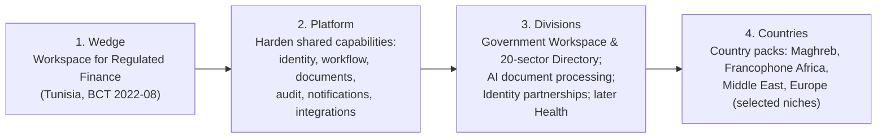

# 2. Updated CIVORA Company Strategy

## 2.1 Identity

**CIVORA is a global technology & digital infrastructure company.** It builds technology that connects people, businesses, governments, institutions and essential services.

Its structure:
- a **parent company**
- **six business divisions**, each with its own customers and go-to-market
- **one shared technology platform**, so every new product starts from proven foundations

Tunisia is the first market, not the boundary.

> **Mission:** make essential services easier, safer and more accountable, for the people who use them and the institutions that provide them.
>
> **Strategy in one line:** *Win one regulated workflow in one market, prove it, then reuse the platform across divisions and countries.*

## 2.2 What changed from Phase 0 (and what did not)

| Topic | Phase 0 | Phase 1 v2.0 | Status of Phase 0 reasoning |
|---|---|---|---|
| Positioning | GovTech platform company (B2G + regulated B2B) | Multi-division technology & infrastructure company | Still valid for Division A and for Tunisia constraints |
| First revenue | L1 B2B trust services (e-KYC) + L2 B2G pipeline | **Workspace for Regulated Finance** (Division B) + Government pipeline on the same engine | e-KYC reasoning updated by new competitor evidence [P][S135][S136] |
| Roadmap | Re-sequenced (D8) | **Original 0→15 order restored** | D8 superseded (C1) |
| Sovereignty, ethics, no-data-sale, citizen-free essential services | Core principles | **Unchanged** | Fully valid |
| "Integrate, don't replace" national systems | Core principle | **Unchanged** (directive §6) | Fully valid |

## 2.3 Strategic logic: the four moves

1. **Wedge.** A product with verified regulatory demand, reachable buyers and short-enough cycles. It must exercise the core platform capabilities.
2. **Platform.** Every capability built for the wedge is designed tenant- and country-aware. It is built simply and *not* over-engineered (directive §9). Phase 2 defines the architecture.
3. **Divisions.** A division is activated only when it passes the gate in [04](04-business-division-strategy.md) §4.3: evidence of demand, regulatory path, platform readiness, and a named owner with budget.
4. **Countries.** Expansion follows Phase 0 Section 13: country packs, sovereign cells and partner-led entry.

## 2.4 Operating principles (company-wide)

1. **Customer evidence over vision.** No division gets a build budget without discovery evidence.
2. **One platform, many products.** No division builds its own authentication, workflow, audit or notification stack.
3. **Integrate with sovereign systems; never replace them.** Every integration carries a status class (1–6) and evidence.
4. **Regulated-grade by default.** Security, privacy, auditability and data residency are product features for every division.
5. **Honest status.** Prototype, pilot and official deployment are never confused (Phase 0 README).
6. **Recurring revenue first.** Subscriptions and licences take priority over one-off projects. Services are accepted only when they create a reusable product or a reference.
7. **Focus.** At most **one active build track and one active pipeline track** until revenue exceeds ~1M TND ARR [A].

## 2.5 Non-negotiables (from the directive and the Citizen Data Charter)

- Never sell personal data.
- Never monetise confidential medical records.
- Never charge citizens for essential identity services.
- Never claim government endorsement without formal authorisation.
- Never assume government APIs are publicly accessible.
- Never access restricted databases without lawful authorisation.
- No real personal data in prototypes.

The full commitments are in [supporting/citizen-data-charter.md](supporting/citizen-data-charter.md).

## 2.6 Revenue model hierarchy

1. **SaaS subscriptions:** Workspace editions, priced per institution tier.
2. **Institutional licences:** on-premises or private-cloud deployments for banks and governments.
3. **Implementation & integration services:** only around the product.
4. **Support & maintenance:** a percentage of licence.
5. **APIs & managed services:** later, from Connect and Identity.
6. **White-label:** for governments (citizen portals) and partners, only where authorised.

Pricing is in [19](19-commercial-and-pricing-strategy.md).

## 2.7 Organisation (first 24 months)

- **One product & engineering team** owns the shared platform and the first product. No division-specific engineering teams yet.
- **Division leads are commercial roles:**
  - an Enterprise (regulated industries) lead from M1
  - a Government relations lead from M10 (Lean) or M2 (Moderate), consistent with Phase 0 staffing
- **Fractional specialists:** DPO, CISO, and health/AI advisers until each division is activated.

## 2.8 What we will not do (now)

- No national citizen super-app in Tunisia.
- No standalone ERP/HR/CRM suite.
- No public hospital EHR.
- No in-house biometric/liveness engine.
- No payment-institution licence.
- No emergency-dispatch or electoral systems.
- No more than one new division activation per 12 months [A].
