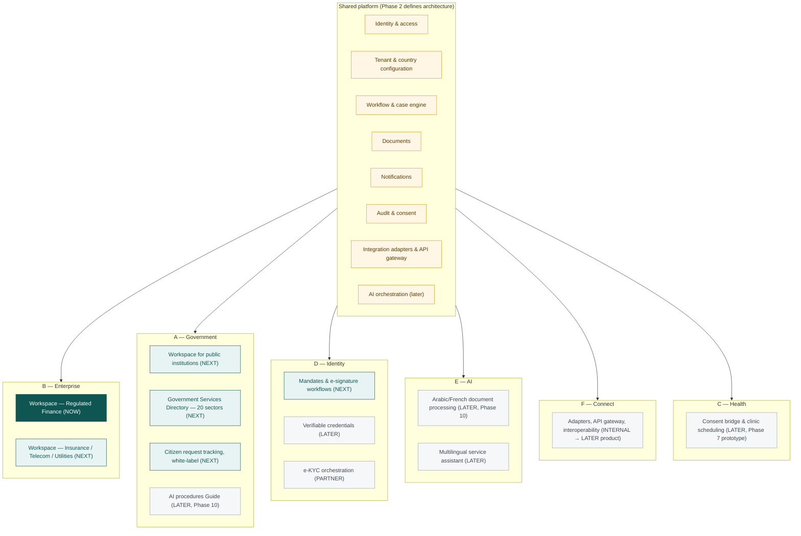

# 3. Global Product Portfolio

Products are grouped by division. Each one is tagged with:
- **Horizon:**
  - **Now** — first product, built in Phases 2–6, piloted in Phase 13
  - **Next** — designed now, built when its roadmap phase arrives or its division activates
  - **Later** — documented as a future requirement
  - **Explore** — research only
  - **No** — rejected
- **Roadmap phase(s)** under the original, unchanged 15-phase roadmap.
- **Score** from the opportunity model ([09](09-opportunity-scoring-matrix.md)), where scored.

## 3.1 Portfolio map

## 3.2 Portfolio register

| Product | Division | Horizon | Customers | Roadmap phase(s) | Score (rank) | Status today |
|---|---|---|---|---|---|---|
| **Workspace — Regulated Finance** (complaints & customer-request case management) | B | **Now** | Banks, financial institutions, payment providers, microfinance | 3, 4, 5, 6 → 11, 12, 13 | 66.6 (#1) | Requirements in [12](12-product-requirements-document.md); wireframes in [16](16-ux-ui-design-strategy.md) |
| Workspace — Insurance / Telecom / Utilities editions | B | Next | Insurers, telecom operators, STEG/SONEDE-type utilities | 14 | (extension of #1) | Future requirement |
| Workspace for public institutions | A | Next | Ministries, agencies, social funds, municipalities, consulates | 6 → 13 | 59.6 (#4) | Government requirements in [supporting](supporting/government-product-requirements.md); clickable prototype exists (independent prototype) |
| Government Services Directory (20 sectors) | A | Next | Institutions (white-label), citizens | 5 | — (enabler) | Catalogue in [05](05-government-master-service-catalog.md) |
| Citizen request tracking (white-label) | A | Next | Institutions | 3, 6 | — | Prototype |
| AI procedures Guide | A / E | Later | Institutions, call centres | **10** | 57.4 (#7) | Future requirement (moved back to Phase 10 per C1) |
| National citizen super-app (Tunisia) | A | **No** | — | — | 28.6 (#12) | Rejected |
| Mandates (acting on behalf) & e-signature workflows | D | Next | Built into Workspace and Government products | 3, 4 | — | Requirements exist (Government PRD) |
| Verifiable credentials (diplomas, attestations) | D | Later | Private universities, employers | 4, 9 | 58.6 (#6) | Future requirement |
| e-KYC & onboarding orchestration | D | Later — **partner** | Banks, payment providers | 3, 12 | 59.0 (#5) | Integrate local/global vendors into Workspace review flows instead of competing |
| Arabic/French intelligent document processing | E | Later (strong #2) | Back offices across divisions | **10** | 62.6 (#2) | Future requirement; candidate second product |
| Multilingual service assistant (enterprise) | E | Later | Banks, insurers, telcos | 10 | 60.4 (#3) | Future requirement; crowded locally [P][S143][S145][S146] |
| Integration / API platform | F | Internal → Later | Integrators, institutions | 2, 12 | 47.8 (#10) | Built as internal capability first |
| Private clinic & practice management | C | Later | Clinics, doctors | 7 | 54.6 (#8) | Deferred |
| Public hospital EHR | C | **No** (now) | — | — | 42.2 (#11) | Rejected for now (national MoH programme) |
| ERP / HR / CRM suite | B | **No** | — | — | 48.6 (#9) | Rejected (saturated market) |

## 3.3 Naming conventions

- **Company brand:** CIVORA. Pending D12 (naming collision in Arabic; see [supporting/brand-identity.md](supporting/brand-identity.md)).
- **Product line names are descriptive:** *CIVORA Workspace*, *CIVORA Directory*, *CIVORA Guide*, *CIVORA Trust*, *CIVORA Connect*. Editions are named by market, e.g. *Workspace — Regulated Finance*.
- **Divisions** are internal and commercial structures. Customers buy products, not divisions.

## 3.4 Portfolio rules

1. A product moves from *Later* to *Next* only when two things are true: its roadmap phase is reached or its division passes the activation gate, **and** discovery evidence exists.
2. A product moves from *Next* to *Now* only by founder decision, with a budget.
3. Every product must reuse at least three shared platform capabilities. If it cannot, it is probably not a CIVORA product.
