# 3. Information Architecture

## 3.1 Citizen app (web + mobile)

**Primary navigation:**
- **Mobile:** bottom tab bar, 5 items. In RTL the order mirrors and Home stays at the start edge.
- **Web:** top navigation plus a persistent "Ask the Guide" entry.

```mermaid
flowchart TB
  H["Home"] --> H1["Next steps & alerts<br/>(status changes, appointments, expiring documents)"]
  H --> H2["Ask the Guide"]
  H --> H3["Life events<br/>(birth, school, work, health, retirement, living abroad)"]
  S["Services"] --> S1["Search"]
  S --> S2["Browse by life event"]
  S --> S3["Browse by institution"]
  S --> S4["Service page<br/>(steps, documents, fees, offices, sources)"]
  S4 --> S5["Start request / Book appointment / Go to official service"]
  R["My requests"] --> R1["Active"]
  R --> R2["Drafts"]
  R --> R3["Completed"]
  R --> R4["Request detail: timeline, documents, messages, correction"]
  R --> R5["Appointments"]
  W["Wallet"] --> W1["Credentials"]
  W --> W2["Present (QR)"]
  W --> W3["Expiry reminders"]
  M["Me"] --> M1["Profile & identity level"]
  M --> M2["Acting for others (mandates)"]
  M --> M3["Privacy center: consents, access log, data export"]
  M --> M4["Security: passkeys, sessions, devices"]
  M --> M5["Language, accessibility, notifications"]
  M --> M6["Help & contact (assisted channels)"]
```

**Global elements on every screen:**
- Language switcher (العربية / Français / English).
- "Acting on behalf of" banner, when active.
- Environment banner (synthetic / pilot).
- Help entry.
- Skip-to-content link.

## 3.2 Workspace (officer back office, web)

| Area | Contents | Roles |
|---|---|---|
| Queues | My queue, team queue, unassigned, SLA at risk, corrections pending | Officer, supervisor |
| Case detail | Applicant summary (minimum necessary), form data, document checklist, pre-check flags, timeline, internal notes, actions (approve / reject / request correction / reassign) | Officer |
| Appointments | Day view per office/counter, check-in, no-show marking | Officer, supervisor |
| Dashboard | Backlog, throughput, median processing time, SLA breaches, top rejection reasons | Supervisor, manager |
| Catalogue editor | Service versions, review queue, sources, translations | Editor, reviewer |
| Configuration | Case types, forms, SLAs, offices, calendars, templates | Tenant admin |
| Audit | Case histories, access reports | Auditor (read-only) |

## 3.3 Platform admin console (CIVORA operators / client IT)

| Area | Contents |
|---|---|
| Tenants & offices | Institutions, offices, staff directory sync |
| Country pack | Languages, policies, numerals, calendars, identity profile |
| Integration register | Adapter status (`SIMULATED` / `SANDBOX` / `AUTHORIZED`), agreement references, approvals |
| Security | Key status, policy bundles, alerts (read-only links to SIEM) |
| Guide | Corpus sources, evaluation runs, flagged answers |

## 3.4 Canonical request status model

Every case type maps its internal states to these **citizen-visible** states. This keeps the meaning consistent across institutions.

| Citizen status | Meaning shown to citizen | Typical next step |
|---|---|---|
| Draft | You haven't submitted yet | Complete and submit |
| Submitted | We received your request | Office review within N days |
| In review | An officer is checking your file | Wait or watch for correction |
| Action needed | We need something from you | Upload / correct by date X |
| Appointment scheduled | Your visit is booked | Bring listed documents |
| Approved | Your request is approved | Collect / receive document |
| Ready for collection / Delivered | Your document is available | Collect at office / download |
| Rejected | Your request was not accepted (reason) | Appeal / new request info |
| Withdrawn | You cancelled | — |
| Closed | Finished | — |

## 3.5 Catalogue content model (service version)

| Field | Type | Required | Notes |
|---|---|---|---|
| `code` | string | ✓ | Stable identifier, e.g. `tn.civil-status.birth-extract` |
| `title` | i18n text | ✓ | AR/FR/EN; plus common names and synonyms for search |
| `summary` | i18n text | ✓ | ≤ 240 characters, plain language |
| `lifeEvents` | enum[] | ✓ | birth, school, work, health, family, housing, vehicle, business, retirement, abroad, death |
| `institution` | reference | ✓ | Owning institution (name only; no logo without permission) |
| `eligibility` | i18n text | — | *Published rules only*, quoted from source; never personalised |
| `steps` | ordered list of i18n steps | ✓ | Each step: action, channel (online/office/post), duration estimate |
| `requiredDocuments` | list | ✓ | Document type, original/copy, conditions ("if born abroad") |
| `fees` | list | — | Amount, currency, payment methods, exemptions; source per fee |
| `processingTime` | range | — | As published; never promised by CIVORA |
| `channels` | list | ✓ | Official online service URL, office locator, phone |
| `offices` | references | — | With hours, holidays, accessibility info |
| `legalBasis` | list of references | — | Text name + JORT reference where available |
| `sources` | list of `{url, publisher, retrievedAt, checksum}` | ✓ | At least one official source |
| `effectiveFrom` / `lastVerified` / `verifiedBy` | date / date / person | ✓ | Shown publicly (`lastVerified`) |
| `assuranceLevel` | enum | — | For CIVORA-hosted requests only |
| `caseType` | reference | — | Link to Workspace case type if the service is digitised in a CIVORA deployment |
| `status` | enum | ✓ | draft / in-review / published / retired |

## 3.6 URL patterns (web)

| Page | Pattern | Example |
|---|---|---|
| Home | `/{lang}` | `/ar`, `/fr`, `/en` |
| Service page | `/{lang}/services/{code}` | `/fr/services/tn.civil-status.birth-extract` |
| Life event | `/{lang}/life-events/{event}` | `/ar/life-events/birth` |
| Guide | `/{lang}/guide` | `/en/guide` |
| Request | `/{lang}/requests/{id}` | (authenticated) |
| Verify credential | `/verify/{token}` | Language negotiated |

The language prefix is explicit (no IP-based guessing). `hreflang` alternates are published for public pages.

## 3.7 Notification taxonomy

| Event | Default channels | Template content (no sensitive data) |
|---|---|---|
| Request submitted | Push, email | Reference number, next step |
| Action needed | SMS, push, email | "Your request {ref} needs an action before {date}" |
| Status changed | Push, email | New status + link |
| Appointment reminder | SMS, push | Date, office, documents to bring |
| Document expiring | Push, email | Document type, expiry date, official renewal link |
| Mandate granted/revoked/used | Push, email (principal) | Who, scope, when |
| Security event | Email, push | New device sign-in, passkey added, recovery started |
