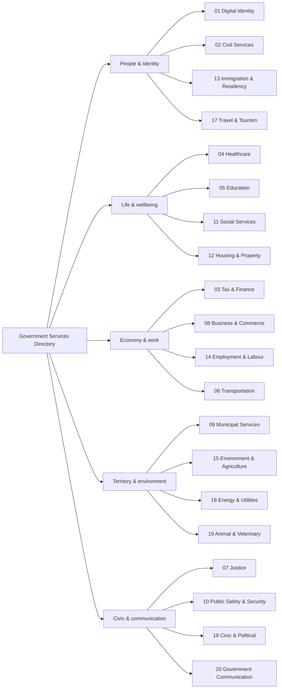

# 15. Information Architecture

This document covers three things:
- **Sections 15.1–15.7:** the Government citizen app and back office. Retained from v1.0 and still the Division A IA.
- **Section 15.8:** the **20-sector Government catalog** taxonomy.
- **Section 15.9:** the **first product**, Workspace — Regulated Finance.
- **Section 15.10:** product structures for the other divisions.

## 15.1 Citizen app (web + mobile)

**Primary navigation:**
- **Mobile:** bottom tab bar, 5 items. In RTL the order mirrors and Home stays at the start edge.
- **Web:** top navigation plus a persistent "Ask the Guide" entry.

```mermaid
flowchart TB
  H["Home"] --> H1["Next steps & alerts<br/>(status changes, appointments, expiring documents)"]
  H --> H2["Ask the Guide"]
  H --> H3["Life events<br/>(birth, school, work, health, retirement, living abroad)"]
  S["Services"] --> S1["Search"]
  S --> S2["Browse by life event"]
  S --> S3["Browse by institution"]
  S --> S4["Service page<br/>(steps, documents, fees, offices, sources)"]
  S4 --> S5["Start request / Book appointment / Go to official service"]
  R["My requests"] --> R1["Active"]
  R --> R2["Drafts"]
  R --> R3["Completed"]
  R --> R4["Request detail: timeline, documents, messages, correction"]
  R --> R5["Appointments"]
  W["Wallet"] --> W1["Credentials"]
  W --> W2["Present (QR)"]
  W --> W3["Expiry reminders"]
  M["Me"] --> M1["Profile & identity level"]
  M --> M2["Acting for others (mandates)"]
  M --> M3["Privacy center: consents, access log, data export"]
  M --> M4["Security: passkeys, sessions, devices"]
  M --> M5["Language, accessibility, notifications"]
  M --> M6["Help & contact (assisted channels)"]
```

**Global elements on every screen:**
- Language switcher (العربية / Français / English).
- "Acting on behalf of" banner, when active.
- Environment banner (synthetic / pilot).
- Help entry.
- Skip-to-content link.

## 15.2 Workspace (officer back office, web)

| Area | Contents | Roles |
|---|---|---|
| Queues | My queue, team queue, unassigned, SLA at risk, corrections pending | Officer, supervisor |
| Case detail | Applicant summary (minimum necessary), form data, document checklist, pre-check flags, timeline, internal notes, actions (approve / reject / request correction / reassign) | Officer |
| Appointments | Day view per office/counter, check-in, no-show marking | Officer, supervisor |
| Dashboard | Backlog, throughput, median processing time, SLA breaches, top rejection reasons | Supervisor, manager |
| Catalogue editor | Service versions, review queue, sources, translations | Editor, reviewer |
| Configuration | Case types, forms, SLAs, offices, calendars, templates | Tenant admin |
| Audit | Case histories, access reports | Auditor (read-only) |

## 15.3 Platform admin console (CIVORA operators / client IT)

| Area | Contents |
|---|---|
| Tenants & offices | Institutions, offices, staff directory sync |
| Country pack | Languages, policies, numerals, calendars, identity profile |
| Integration register | Adapter status (`SIMULATED` / `SANDBOX` / `AUTHORIZED`), agreement references, approvals |
| Security | Key status, policy bundles, alerts (read-only links to SIEM) |
| Guide | Corpus sources, evaluation runs, flagged answers |

## 15.4 Canonical request status model

Every case type maps its internal states to these **citizen-visible** states. This keeps the meaning consistent across institutions.

| Citizen status | Meaning shown to citizen | Typical next step |
|---|---|---|
| Draft | You haven't submitted yet | Complete and submit |
| Submitted | We received your request | Office review within N days |
| In review | An officer is checking your file | Wait or watch for correction |
| Action needed | We need something from you | Upload / correct by date X |
| Appointment scheduled | Your visit is booked | Bring listed documents |
| Approved | Your request is approved | Collect / receive document |
| Ready for collection / Delivered | Your document is available | Collect at office / download |
| Rejected | Your request was not accepted (reason) | Appeal / new request info |
| Withdrawn | You cancelled | — |
| Closed | Finished | — |

## 15.5 Catalogue content model (service version)

| Field | Type | Required | Notes |
|---|---|---|---|
| `code` | string | ✓ | Stable identifier, e.g. `tn.civil-status.birth-extract` |
| `title` | i18n text | ✓ | AR/FR/EN; plus common names and synonyms for search |
| `summary` | i18n text | ✓ | ≤ 240 characters, plain language |
| `lifeEvents` | enum[] | ✓ | birth, school, work, health, family, housing, vehicle, business, retirement, abroad, death |
| `institution` | reference | ✓ | Owning institution (name only; no logo without permission) |
| `eligibility` | i18n text | — | *Published rules only*, quoted from source; never personalised |
| `steps` | ordered list of i18n steps | ✓ | Each step: action, channel (online/office/post), duration estimate |
| `requiredDocuments` | list | ✓ | Document type, original/copy, conditions ("if born abroad") |
| `fees` | list | — | Amount, currency, payment methods, exemptions; source per fee |
| `processingTime` | range | — | As published; never promised by CIVORA |
| `channels` | list | ✓ | Official online service URL, office locator, phone |
| `offices` | references | — | With hours, holidays, accessibility info |
| `legalBasis` | list of references | — | Text name + JORT reference where available |
| `sources` | list of `{url, publisher, retrievedAt, checksum}` | ✓ | At least one official source |
| `effectiveFrom` / `lastVerified` / `verifiedBy` | date / date / person | ✓ | Shown publicly (`lastVerified`) |
| `assuranceLevel` | enum | — | For CIVORA-hosted requests only |
| `caseType` | reference | — | Link to Workspace case type if the service is digitised in a CIVORA deployment |
| `status` | enum | ✓ | draft / in-review / published / retired |

## 15.6 URL patterns (web)

| Page | Pattern | Example |
|---|---|---|
| Home | `/{lang}` | `/ar`, `/fr`, `/en` |
| Service page | `/{lang}/services/{code}` | `/fr/services/tn.civil-status.birth-extract` |
| Life event | `/{lang}/life-events/{event}` | `/ar/life-events/birth` |
| Guide | `/{lang}/guide` | `/en/guide` |
| Request | `/{lang}/requests/{id}` | (authenticated) |
| Verify credential | `/verify/{token}` | Language negotiated |

The language prefix is explicit (no IP-based guessing). `hreflang` alternates are published for public pages.

## 15.7 Notification taxonomy

| Event | Default channels | Template content (no sensitive data) |
|---|---|---|
| Request submitted | Push, email | Reference number, next step |
| Action needed | SMS, push, email | "Your request {ref} needs an action before {date}" |
| Status changed | Push, email | New status + link |
| Appointment reminder | SMS, push | Date, office, documents to bring |
| Document expiring | Push, email | Document type, expiry date, official renewal link |
| Mandate granted/revoked/used | Push, email (principal) | Who, scope, when |
| Security event | Email, push | New device sign-in, passkey added, recovery started |

## 15.8 CIVORA Government — 20-sector catalog taxonomy

The Directory taxonomy is **Sector → Subcategory → Service**. Each service also carries:
- life-event tags
- the responsible institution (country-specific)
- channels
- sources

Sector codes are global (01–20). Services are defined per country pack. Source: [05](05-government-master-service-catalog.md) and [data/government-service-catalog.json](data/government-service-catalog.json).

**Navigation in the citizen Directory** (web and app):
- Browse by **life event** (primary for citizens).
- Browse by **sector** (the 5 groups above, then 20 sectors).
- Browse by **institution**.
- **Search**: AR/FR/EN with Arabic normalisation; Derja synonyms via the Phase 10 Guide later.

Every service page follows the content model in Section 15.5.

**URL pattern:**
- `/{lang}/services/{sector}/{subcategory}/{service-code}`
- e.g. `/fr/services/02-civil/civil-status-certificates/tn.civil-status.birth-extract`

## 15.9 Workspace — Regulated Finance edition

### Agent console (desktop-first web)

| Area | Contents | Roles |
|---|---|---|
| **My queue** | Assigned cases sorted by remaining time; at-risk/overdue filters | Handler |
| **Team queues** | By team, category, branch; unassigned | Supervisor |
| **Case** | Header (reference, category, status, deadline timer) · customer summary (minimum data) · timeline · documents · notes & sub-tasks · decision panel · communications | Handler, supervisor |
| **New case** | Intake form (agent) | Branch staff, handler |
| **Escalations** | Mediator/regulator cases; exports | Correspondent |
| **Dashboard** | Volumes, deadline performance, categories, branches, root causes | Head of customer relations |
| **Reports** | Annual board report wizard; regulator statistics | Head of customer relations, compliance |
| **Administration** | Users, teams, branches, categories & SLAs, templates, holidays, retention, SSO, API keys | Tenant admin |
| **Audit** | Access and change logs; integrity check; export | Compliance / auditor (read-only) |

### Customer status page (mobile-first web, no account)

1. Enter reference + receive a one-time code.
2. Status page shows:
   - status in plain language
   - deadline
   - next step
   - messages and replies
   - documents shared by the institution
3. Decision with reasons, and how to contact the mediator.
4. Satisfaction survey (optional).

### Canonical complaint states (customer-visible wording)

| Internal state | Customer sees (EN) | FR | AR |
|---|---|---|---|
| Received | We received your complaint | Réclamation reçue | تمّ استلام شكايتك |
| In analysis | We are analysing your complaint | En cours d'analyse | قيد الدراسة |
| Information requested | We need information from you | Information demandée | نحتاج إلى معلومات منك |
| Pending internal | We are checking with another department | Vérification interne en cours | تحقّق داخلي جارٍ |
| Decision issued | A decision has been issued | Décision rendue | صدر القرار |
| Closed | Closed | Clôturée | مُغلقة |
| Escalated to mediator | Your case is with the banking mediator | Dossier transmis au médiateur bancaire | الملف لدى الموفّق المصرفي |

*AR/FR wording requires native review (see the UX writing guidelines). The Tunisian banking-sector Arabic term for "complaint" (شكاية vs تظلّم vs مطلب) must be confirmed with design partners.*

## 15.10 Product structures for other divisions (future; top-level only)

| Division | Product | Top-level structure |
|---|---|---|
| D — Identity | Mandates & e-signature (embedded) | Principal ↔ agent mandates · signature requests · certificates · evidence |
| D — Identity | Verifiable credentials (later) | Issuer console (templates, issuance, revocation) · holder wallet · verifier page |
| E — AI | Document processing (Phase 10) | Pipelines · document types · extraction review queue · accuracy dashboard · model policy |
| E — AI | Guide (Phase 10) | Corpus sources · evaluation runs · flagged answers · channel embeds |
| F — Connect | Integration console (internal → product) | Adapters · credentials (vault refs) · call logs · health · integration register (classes 1–6) |
| C — Health | Health bridge (Phase 7 prototype) | Consents · access requests · break-glass review · clinic schedules · patient access log |
