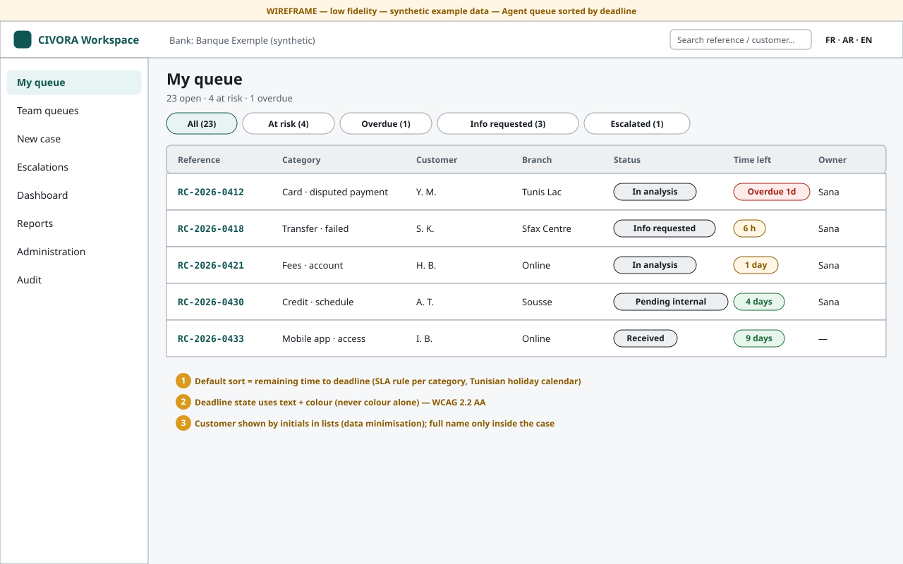
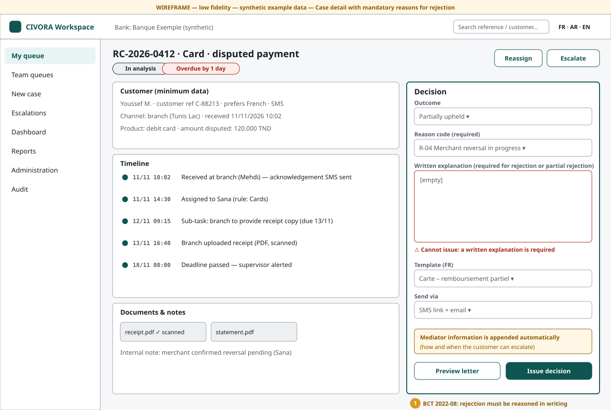
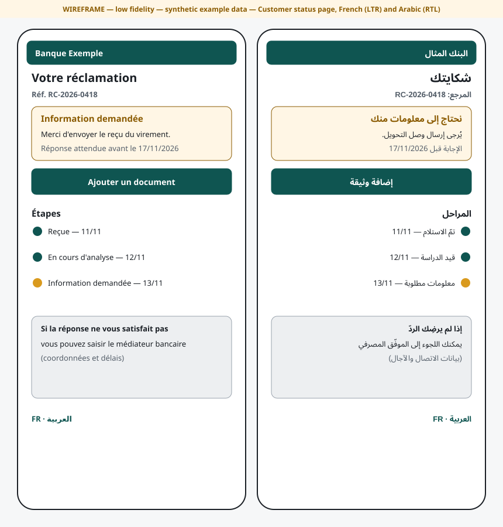

# 16. UX/UI Design Strategy

## 16.1 Design philosophy

The directive asks for a design that is premium, minimalist, professional, accessible, secure, modern and international. Applied to CIVORA:

| Principle | Means in practice |
|---|---|
| **Calm authority** | Restrained palette (teal and slate, jasmine-gold accent); no state symbols; generous whitespace in citizen and customer views. Density only where professionals need it |
| **Regulated clarity** | Deadlines, reasons, statuses and audit are always explicit, in text, not only colour |
| **Bidirectional by default** | Every screen is designed in Arabic RTL and French/English LTR at the same time |
| **Accessible to everyone** | WCAG 2.2 AA minimum; senior and low-literacy modes for citizen products |
| **Security made visible** | Session, device and access information is visible to users; no dark patterns |
| **One system, many products** | One design system and token set; products differ by density and navigation, not by visual identity |

## 16.2 Interface strategy by product and channel

| Product | Primary channel | Secondary | Mobile strategy | Rationale |
|---|---|---|---|---|
| **Workspace RF — agent console** | **Desktop web** (1280–1920 px) | Tablet for branch staff | Responsive down to 1024 px; branch intake form usable on tablet | Professionals work at desks with dense queues |
| **Workspace RF — customer status page** | **Mobile web** (no app install) | Desktop web | Mobile-first PWA-style page; works on 3G and low-end Android | Customers won't install an app for a complaint; link via SMS |
| Workspace RF — admin & reports | Desktop web | — | Not targeted | Configuration tasks |
| Government Workspace | Desktop web | Tablet (counters) | As above | Same engine |
| Citizen app (white-label, Government) | Responsive web first | **React Native** app per institution or country | Native app only where the institution wants push/wallet features | Phase 0 D7 stack |
| Directory (20 sectors) | Responsive web (SEO, fast) | Embeds in institutions' sites/apps | Mobile-first content pages | Reach and speed |
| Guide (Phase 10) | Web widget | App and call-centre console | — | Future |

**Web strategy:**
- Next.js (Phase 0 D7). Server-rendered public pages; authenticated consoles inside each country cell.
- Logical CSS properties for RTL.
- Performance budgets per surface (PRD §12.7).

**Mobile strategy:**
- **No native app for the first product.** The customer status page is mobile web.
- Native React Native apps arrive with the Government citizen products or Identity wallet features, when an institution requires them.

## 16.3 Wireframes — first product (low fidelity)

All wireframes use synthetic example data.

| # | Screen | File |
|---|---|---|
| 1 | Agent queue sorted by deadline | [wf-01-agent-queue.svg](../../design/wireframes/wf-01-agent-queue.svg) |
| 2 | Case detail and decision panel, with mandatory written reasons | [wf-02-case-decision.svg](../../design/wireframes/wf-02-case-decision.svg) |
| 3 | Escalations and case-file export (mediator/BCT) | [wf-03-escalation-export.svg](../../design/wireframes/wf-03-escalation-export.svg) |
| 4 | Dashboard and annual board report wizard | [wf-04-dashboard-report.svg](../../design/wireframes/wf-04-dashboard-report.svg) |
| 5 | Administration: categories, deadlines, templates | [wf-05-admin-categories.svg](../../design/wireframes/wf-05-admin-categories.svg) |
| 6 | Customer status page, French (LTR) and Arabic (RTL) | [wf-06-customer-status-mobile.svg](../../design/wireframes/wf-06-customer-status-mobile.svg) |

**Government track:** the clickable, tested prototype (citizen app + officer workspace, AR/FR/EN, 0 axe violations in 21 states) remains at [design/prototype/index.html](../../design/prototype/index.html). It is an **independent prototype (class 4)**.

**Next design step:** turn wireframes 1–6 into a clickable high-fidelity prototype for design-partner sessions, using the existing design system. Planned in the [90-day plan](22-90-day-execution-plan.md) as a Phase 1 activity. It is not Phase 2 work.

## 16.4 Accessibility requirements (all products)

- **WCAG 2.2 AA** is the release gate for every customer- and citizen-facing surface and every agent console.
- Keyboard-complete agent workflows. Visible focus. Queue tables with `aria-sort`. Deadline state announced in text.
- Screen readers tested in Arabic and French (TalkBack, VoiceOver, NVDA).
- Reflow at 320 px for customer pages. 200% zoom without loss.
- Status never conveyed by colour alone. Contrast verified from tokens (44/44 pairs pass).
- Cognitive accessibility: plain language; one primary action per screen for customers; error messages say how to fix.
- Accessible authentication: no cognitive tests; OTP paste allowed; passkeys supported where accounts exist.

## 16.5 Localisation strategy

| Item | Rule |
|---|---|
| Languages | Arabic (MSA, Tunisian administrative and banking vocabulary), French, English. Derja only in the Guide (Phase 10) |
| Templates | Institutions maintain AR and FR templates. Compliance approval is per language |
| Terminology | Official banking and data-protection terms verified against the Arabic regulatory texts: complaint = شكوى, banking mediator = الموفّق البنكي ([validation/arabic-legal-terminology.md](validation/arabic-legal-terminology.md)); entries added to [supporting/ux-writing-and-terminology.md](supporting/ux-writing-and-terminology.md) §7.5 |
| Numbers & dates | Western Arabic digits for Tunisia; TND with 3 decimals; `dd/mm/yyyy` |
| International | Country packs add languages (e.g. Eastern Arabic digits for Gulf) without design changes |

## 16.6 Usability validation plan (Phase 1 activities)

- **Round 1:** high-fidelity clickable prototype with 2–3 design partners. Tasks:
  - intake
  - decide with reasons
  - export a case file
  - generate the report
  - check status as a customer (AR/FR)
- **Round 2:** after iteration, ≥ 8 agents and ≥ 8 customers.
- **Targets:** agent SUS ≥ 75; task success ≥ 90% for intake and decision tasks.
- **Government-track tests:** per [supporting/user-research-kit.md](supporting/user-research-kit.md) §8.9.
