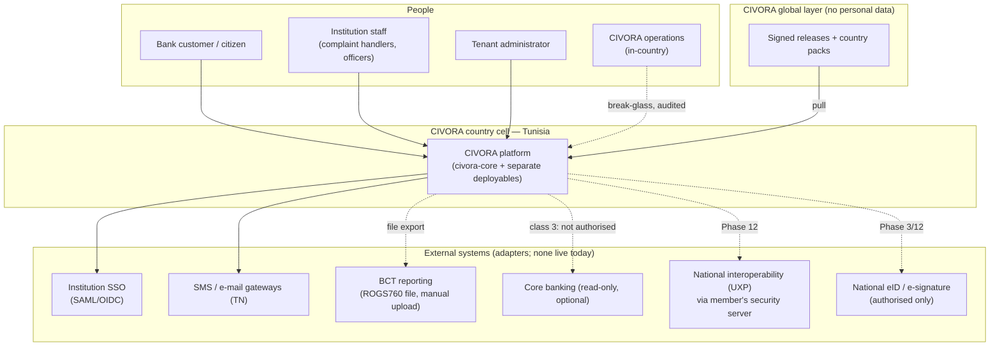
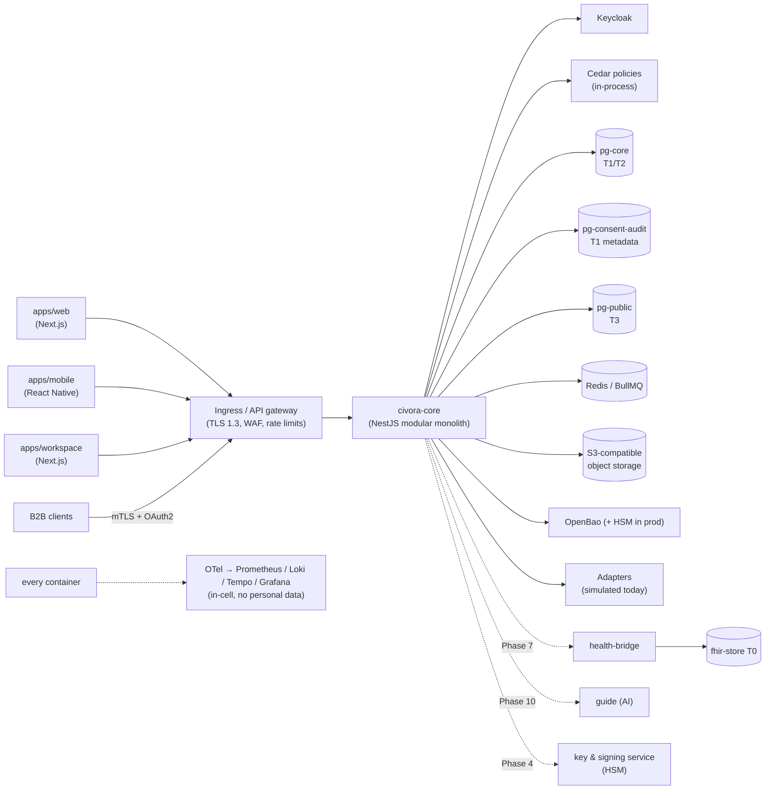

# 1. Architecture Overview

| | |
|---|---|
| Phase | Phase 2 — Technical Architecture (original roadmap, unchanged) |
| Status | ADRs **accepted** by the founder on 21 Nov 2026 (P2-D1; 6 with conditions). Threat model: **external security review still pending** (CF-2). Phase 1 **approved** 21 Nov 2026 (P1-D12) |
| Builds on | Phase 0 §8 (technical architecture), §9 (database), §10 (security); Phase 1 [18](../phase-1/18-shared-platform-requirements.md) (shared platform requirements) and the PRD NFRs ([12](../phase-1/12-product-requirements-document.md) §12.7) |
| What is new in Phase 2 | Phase 0 proposals turned into 29 ADRs. A walking skeleton, CI/CD, IaC and a policy-engine spike were built and tested ([17](17-technical-validation-strategy.md)) |

## 1.1 What the architecture must achieve

| Driver (source) | Architectural answer | Where |
|---|---|---|
| Six divisions on **one shared platform** (D1, P1-D1) | One engine, configured per division and product; no division-specific forks | [02](02-business-divisions-and-capability-map.md) |
| Personal data stays in the country (D9; Law 2004-63 Art. 50–52) | **Country cells**: isolated deployments per country. The global layer holds no personal data | [03](03-global-core-and-country-configuration.md), ADR-004 |
| Regulated financial institutions as first customers (P1-D2, P1-D3 conditional) | Tenants with isolation tiers up to customer-hosted cells | [04](04-multi-tenant-architecture.md), ADR-016, ADR-019 |
| Different legal regimes for health, identity, financial and government data (Phase 1 §18.2) | Data tiers T0–T3 with separate clusters and keys; health runs as a separate deployable | [05](05-data-architecture-and-governance.md), ADR-003, ADR-018 |
| Small team (6–8 engineers in MVP) | **Modular monolith** in TypeScript; boring, proven components | ADR-001, ADR-002 |
| Rules change by regulator and country (FR-66) | Country packs and rule packs as signed, versioned configuration | ADR-017 |
| Auditability (Law 2004-63 Art. 18–19; BCT 2022-08) | Hash-chained audit as a platform service; access logged with purpose | [07](07-security-and-privacy-architecture.md) |
| Arabic first, RTL, WCAG 2.2 AA | i18n and RTL in shared packages; accessibility is a release gate | ADR-014, ADR-022 |
| No integration exists yet (integration register: 0 live) | Adapter framework; every adapter ships as `simulated` first | [11](11-integration-architecture.md), ADR-028 |

## 1.2 System context (C4 level 1)

Dotted lines are not built and not authorised. Integration status: [Phase 0 integration register](../phase-0/integration-status-register.md).

## 1.3 Containers in one cell (C4 level 2)

| Container | State in Phase 2 | Built in |
|---|---|---|
| `civora-core` | **Walking skeleton runs**: health, locales, metrics, flags, country pack, 9 empty bounded contexts | 3–8 (features) |
| `apps/web`, `apps/mobile`, `apps/workspace` | Placeholders (repository structure only) | 3, 4, 5, 6 |
| `services/health-bridge` | Placeholder | 7 |
| `services/guide` | Placeholder | 10 |
| Key & signing service | Not created. OpenBao transit covers Phase 2–3 | 4 (with credentials/e-signature) |
| Keycloak, PostgreSQL ×3, Redis, S3 store, OpenBao, observability | **Running in the dev cell** | — |

## 1.4 Architecture principles

1. **Platform first, product configured.** Divisions and products differ by configuration (case types, rule packs, taxonomies), not by code forks ([02](02-business-divisions-and-capability-map.md)).
2. **Sovereign by construction.** A cell needs nothing outside its country at runtime. The global layer distributes code and non-personal configuration only.
3. **Least data.** Store pointers, not copies (Phase 0 §9.1). Events carry references. Logs carry no personal data.
4. **Isolation in depth.** Cell → tenant → module schema → row-level security → policy decision → field encryption.
5. **Simulated until authorised.** No adapter talks to a real institution without an `AUTHORIZED` entry in the integration register.
6. **Everything as code, everything verified.** Infrastructure, policies, rule packs and API contracts are versioned and checked in CI.
7. **Boring technology, few moving parts.** No microservices before the Phase 0 §8.11 triggers. No second programming language without an ADR.
8. **Reversible decisions stay cheap.** Engine-neutral test suites (policies), adapters (integrations) and S3/OIDC/OpenTelemetry standards keep exit paths open.

## 1.5 Document map

| # | Document | Mission topic |
|---|---|---|
| 00 | [Specification and constraint audit](00-specification-and-constraint-audit.md) | Original Phase 2 scope, constraints |
| 01 | This overview | Diagrams |
| 02 | [Business divisions and capability map](02-business-divisions-and-capability-map.md) | Six divisions |
| 03 | [Global core and country configuration](03-global-core-and-country-configuration.md) | Global core, country packs |
| 04 | [Multi-tenant architecture](04-multi-tenant-architecture.md) | Multi-tenancy |
| 05 | [Data architecture and governance](05-data-architecture-and-governance.md) + [data inventory](data/data-inventory.csv) | Database, data governance |
| 06 | [Identity and access](06-identity-and-access.md) | IAM |
| 07 | [Security and privacy architecture](07-security-and-privacy-architecture.md) | Security, privacy |
| 08 | [Threat model (STRIDE)](08-threat-model.md) | Security |
| 09 | [Data-flow diagrams](09-data-flow-diagrams.md) | Diagrams |
| 10 | [API architecture and standards](10-api-architecture-and-standards.md) | API |
| 11 | [Integration architecture](11-integration-architecture.md) | Integrations |
| 12 | [AI and agent infrastructure](12-ai-and-agent-infrastructure.md) | AI |
| 13 | [Cloud and deployment architecture](13-cloud-and-deployment-architecture.md) | Cloud, deployment |
| 14 | [Scalability and performance](14-scalability-and-performance.md) | Scalability |
| 15 | [Observability, backup and DR](15-observability-backup-and-dr.md) | Monitoring, backup, DR |
| 16 | [Infrastructure plan](16-infrastructure-plan.md) | Infrastructure, CI/CD |
| 17 | [Technical validation strategy](17-technical-validation-strategy.md) | Validation |
| 18 | [Coding standards](18-coding-standards.md) | Engineering standards |
| 19 | [Traceability matrix](19-traceability-matrix.md) | Traceability |
| — | [ADR index](adr/README.md) | 29 ADRs |
| — | [Phase 2 readiness report](phase-2-readiness-report.md) | Status |
