# 2. Business Divisions and Capability Map

| | |
|---|---|
| Purpose | Show how the **six divisions** (Phase 1 [04](../phase-1/04-business-division-strategy.md)) run on **one shared platform** (D1, P1-D1) without code forks |
| Inputs | Division stances (Phase 1 §4.1); capability register with timing (Phase 1 [18](../phase-1/18-shared-platform-requirements.md) §18.1); data domains (§18.2); non-goals (§18.3) |
| Rule | A division adds **configuration, adapters and UI**. It does not add a second engine, a second database technology or a second language |

## 2.1 Divisions on one platform

```mermaid
flowchart TB
  subgraph div["Divisions (Phase 1 §4.1)"]
    A["A Government<br/>active pipeline"]
    B["B Enterprise<br/>first revenue: Workspace RF"]
    C["C Health<br/>deferred (Phase 7 synthetic)"]
    D["D Identity<br/>incubate / partner"]
    E["E AI<br/>incubate (Phase 10)"]
    F["F Connect<br/>internal capability"]
  end
  subgraph plat["Shared platform (one codebase, one cell per country)"]
    IAM["identity-access"]
    CASE["cases (workflow engine)"]
    CAT["catalogue / taxonomy"]
    NOTIF["notifications"]
    DOC["documents (object storage)"]
    AUD["consent-audit"]
    CFG["country-config + rule packs"]
    INT["integrations (adapters)"]
    APPT["appointments"]
    WAL["wallet"]
    PAY["payments"]
  end
  subgraph sep["Separate deployables"]
    HB["health-bridge (T0)"]
    GU["guide (AI)"]
    KS["key & signing service"]
  end
  A --> CASE & CAT & APPT & AUD & NOTIF
  B --> CASE & CAT & NOTIF & DOC & AUD & CFG
  C --> HB
  D --> IAM & WAL & KS
  E --> GU
  F --> INT
```

## 2.2 Division × platform capability matrix

Legend:
- **●** needed by the division's first product
- **○** needed later
- blank: not needed
- *phase* = roadmap phase in which the capability is built (Phase 1 §18.1)

| # | Capability (Phase 1 §18.1) | Module / service | Phase | A Gov | B Ent | C Health | D Identity | E AI | F Connect |
|---|---|---|---|---|---|---|---|---|---|
| 1 | Authentication | identity-access + Keycloak | 3 | ● | ● | ○ | ● | ○ | |
| 2 | Authorisation | Cedar policies in core (ADR-006) | 3, 6 | ● | ● | ● (T0) | ● | ○ | ○ |
| 3 | Tenant management | identity-access + config | 3 | ● | ● | ○ | ○ | ○ | ○ |
| 4 | Country configuration | country-config, country packs (ADR-017) | **2**–3, 15 | ● | ● | ● | ● | ● | ● |
| 5 | Identity & trust services | identity-access, wallet, key service | 3, 4, 12 | ○ | OTP only | ○ | ● | | |
| 6 | Notifications | notifications | 3–6 | ● | ● | ○ | ○ | | |
| 7 | Document management | documents in object storage | 4 | ● | ● | ○ | ○ | ○ | |
| 8 | Workflow / case engine | cases | 6 | ● | ● (core) | ○ | | ○ | |
| 9 | Taxonomy / catalogue | catalogue | 5 | ● (Directory) | ● (categories) | ○ | | ○ | |
| 10 | API management | gateway + API standards (ADR-015) | 6, 12 | ○ | ● | ○ | ● | | ● |
| 11 | Audit logging | consent-audit | 3–6 | ● | ● | ● | ● | ● | ● |
| 12 | Consent management | consent-audit | 3+, 7 | ● | — (lawful basis: legal obligation [A — counsel]) | ● | ● | ○ | |
| 13 | AI orchestration | guide + model gateway (ADR-010, ADR-026) | 10 | ○ | ○ (doc processing) | | | ● | |
| 14 | Integration infrastructure | integrations (ADR-028) | 12 | ● | ○ | ● | ● | | ● |
| 15 | Monitoring & observability | in-cell OTel stack (ADR-011) | **2**, 11 | ● | ● | ● | ● | ● | ● |
| 16 | Security policies | OpenBao, HSM, SDLC (ADR-012, ADR-027) | **2**, 11 | ● | ● | ● | ● | ● | ● |
| 17 | Reporting & analytics | cases (per-tenant reporting) | 6 | ● | ● (ROGS760) | ○ | | | |
| 18 | Billing (CIVORA's own) | outside the product (accounting tool) | 8 (design) | | | | | | |

Phase 2 builds only rows 4, 15 and 16 (platform foundations) plus the skeleton every other row plugs into.

## 2.3 What each division adds (configuration, not forks)

| Division | Adds | Data domain (Phase 1 §18.2) | Isolation |
|---|---|---|---|
| **A Government** | Directory content (20 sectors), case types for public services, citizen portal theme, consent flows, public-sector rule packs | Government data | Separate tenants **and cells** per institution where hosting rules require (Circular 5/2026; Decree-law 2023-17) |
| **B Enterprise** | Workspace RF case types (FR-60), rule packs RP-BCT-2022-08 / 2026-10 / 2020-11 (FR-66), ROGS760 export, SSO adapters | **Financial customer data** | Tenant per institution; dedicated database or customer-hosted cell on request (ADR-016, ADR-019) |
| **C Health** | FHIR resources, consent-for-care policies, health-bridge | Health data (**T0**) | Separate deployable, cluster, keys, network segment (ADR-001, ADR-003) |
| **D Identity** | Mandates, credentials, e-signature flows, e-KYC partner adapters | Identity data | Separate store and keys; **no biometric templates** (Phase 0 §11.3) |
| **E AI** | Models behind a gateway, prompts, evaluation sets, agent tools | Uses the domain of the calling product, with **no personal data to foreign models** (D10) | Separate deployable; no direct database access ([12](12-ai-and-agent-infrastructure.md)) |
| **F Connect** | Adapters (UXP via member security server, PSPs, messaging, core banking), API gateway policies | Carries other domains' data in transit only | Adapter registry + integration register gate (ADR-028) |

## 2.4 Guardrails that keep one platform

1. **Module boundaries are enforced in CI.** The fitness function `scripts/check-module-boundaries.mjs` rejects imports of another module's internals ([18](18-coding-standards.md) §4).
2. **No division-specific branches or builds.** One image per release. Divisions are enabled per cell and tenant through country packs and feature flags (ADR-017, ADR-021).
3. **A new separately deployed service needs an ADR** that cites a Phase 0 §8.11 trigger (measured scaling, compliance boundary, team topology, availability tier).
4. **Division activation gate** (Phase 1 §4.3) applies before a division gets production tenants. Architecture readiness is one of its five gates; the others are commercial and legal.
5. **Non-goals hold** (Phase 1 §18.3): no low-code builder, no multi-country runtime before Phase 15, no AI components before Phase 10.

## 2.5 Sensitivity to the first-product decision (P1-D3, conditional)

The case engine, taxonomy, rule packs, notifications and audit serve both Division A and Division B. If Phase 1 validation moves the first product:
- **to Government:** a public-sector rule pack comes earlier. The architecture is unchanged.
- **to document processing (Division E):** design work for ADR-010 and ADR-026 is brought forward. AI components are still built in Phase 10.

See [00](00-specification-and-constraint-audit.md) §4.
