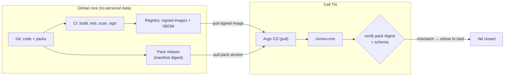

# 3. Global Core and Country Configuration

| | |
|---|---|
| Decisions | ADR-004 (country cells), ADR-017 (country packs and rule packs), ADR-021 (feature flags), ADR-022 (identifiers, time, money, locale) |
| Built in Phase 2 | `packages/country-packs` (schemas, TN pack v0, three BCT rule packs, manifest and digest verification), `packages/feature-flags`, `packages/i18n`, `country-config` module in `civora-core` |
| Constraint | **No multi-country runtime before Phase 15** (Phase 1 §18.3). Phase 2 makes country logic *replaceable*, not multi-country |

## 3.1 Three layers

| Layer | Contains | Personal data | Runs where |
|---|---|---|---|
| **Global core** | Source code, signed images, Helm chart, schemas for packs, the pack registry (Git + signed releases) | **None** | Development infrastructure (any cloud; D9 allows synthetic-only dev/staging anywhere) |
| **Country pack** | Locales, numbering, currency, time zone, calendar, identifier formats, hosting rules, legal references, rule-pack list, default feature flags | None (configuration only) | Pulled into each cell at deploy time |
| **Country cell** | The running platform for one country, its tenants and all their data | **All** personal data of that country | In-country host (D9; Law 2004-63 Art. 50–52) |

A cell never calls another cell. The global layer never pulls data from a cell. Optional aggregated product telemetry is opt-in per cell and anonymous (Phase 0 §8.4).

## 3.2 Country pack (implemented)

The schema is [packages/country-packs/schema/country-pack.schema.json](../../packages/country-packs/schema/country-pack.schema.json). The Tunisia v0 pack is [packages/country-packs/tn/country-pack.json](../../packages/country-packs/tn/country-pack.json).

| Section | TN v0 value | Source / status |
|---|---|---|
| `status` | `synthetic-development-only` | Pilot and production **refuse** this pack at start-up (tested) |
| Locales | `ar-TN` (default), `fr-TN` (fallback), `en` | Phase 1 IA §15 |
| Numbering | `latn` (Western Arabic digits) | Tunisian administrative practice; Phase 1 design system |
| Currency | TND, **3 minor units** (millimes) | ISO 4217 |
| Time zone, weekend | Africa/Tunis; Saturday–Sunday | — |
| Holidays 2026–2027 | Fixed dates + **estimated** lunar dates, marked unverified | Must be confirmed against the official decree each year before pilot |
| Identifier formats | CIN **synthetic range only** `^99[0-9]{6}$`; phone `^\+2160[0-9]{7}$`; e-mail `.invalid` | Real formats are added only in a pilot pack with counsel sign-off |
| Hosting rules | Dev/staging: any host, synthetic only. Pilot/production: CNI or labelled N-Cloud/G-Cloud host in Tunisia, or customer premises | D9 |
| Personal-data transfer abroad | Prohibited without INPDP authorisation | Law 2004-63 Art. 50–52 |
| Rule packs | RP-BCT-2022-08, RP-BCT-2026-10, RP-BCT-2020-11 | Phase 1 legal verification |
| Feature flags | `meta.locales.english` on; `platform.synthetic-banner` on; `workspace.customer-status-page` off; `integrations.production-adapters` **off and locked** | ADR-021 |

**Integrity.**
- `buildManifest` writes a SHA-256 digest for every file and an overall digest.
- `loadCountryPack` recomputes the digests and validates both JSON Schemas (draft 2020-12). It also checks locale consistency, rule-pack references and every regular expression.
- Any mismatch stops the service. The digest is reported by `GET /health`, so operators can see which pack version is live.
- Tamper detection has a unit test.

## 3.3 Rule packs (FR-66, R-4)

A rule pack encodes one regulatory text as data. The code reads the pack and never hard-codes a deadline.

| Pack | Text | Key rules encoded | Open questions |
|---|---|---|---|
| RP-BCT-2022-08 | BCT Circular 2022-08 (banks, leasing, factoring) | Response ceiling **15 banking working days from acknowledgement**; the institution may set a shorter deadline, never a longer one; Annex 1 mandatory fields; 8 Annex 3 subject categories; ROGS760 annual statement within 45 days (XML) | Q-07: may "information requested" pause the deadline? Encoded as **not allowed** until counsel answers |
| RP-BCT-2026-10 | BCT Circular 2026-10 (payment institutions) | Statements RAA10/RAA20; **no ceiling encoded** (`null`) because none was verified | Ceiling to be confirmed by counsel |
| RP-BCT-2020-11 | BCT Circular 2020-11 | Ceiling **7 working days**; start point not specified in the text; quarterly statement due at the end of the month after each quarter (Art. 44) | Start point to be confirmed |

**Versioning rules (ADR-017):**
- Packs follow semantic versioning.
- A tenant **activates** a specific pack version. Activations are stored in the `config` schema from Phase 3.
- A case records the pack version that applied when it was opened, so deadlines never change retroactively.
- A new regulatory text means a new pack version, reviewed by two people (one of them compliance or counsel), with the source reference in the pack.

**Calendar.**
- `addWorkingDays` and `workingDaysBetween` use the pack calendar. The start day is not counted.
- Tested examples: 18 Nov 2026 + 15 → 9 Dec 2026; 26 Oct 2026 + 15 → 16 Nov 2026.

## 3.4 Feature flags (ADR-021)

- Built on the OpenFeature API with an in-process provider. **No external flag service**: flags are configuration and must stay in the cell.
- Defaults come from the country pack. Tenant overrides are applied by `tenantId` in the evaluation context.
- Platform-locked prefixes (`platform.`, `integrations.production-adapters`) cannot be overridden by a tenant.
- Overrides of undeclared flags, or of the wrong type, are rejected.
- Flags are for **release control and per-tenant options**. They are not for permissions (policies), and not for regulatory rules (rule packs).

## 3.5 Localisation (ADR-014, ADR-022)

- `packages/i18n` negotiates `Accept-Language` (RFC 9110 q-values; exact match, then language, then fallback), gives text direction, and formats numbers and dates with `-u-nu-latn` in the cell's time zone.
- `GET /v1/meta/locales` returns the cell's locales with direction and native names, and sets `Content-Language` and `Vary`. It is tested for Arabic → `rtl` and for an unsupported language falling back to French.
- Arabic is the default for TN. Every user-facing string comes from catalogues; plurals use `Intl.PluralRules`.

## 3.6 Adding a country later (Phase 15, not before)

1. Create `packages/country-packs/<cc>/` from the schema, with status `synthetic-development-only`.
2. Encode that country's regulatory texts as rule packs (legal verification first, as in Phase 1).
3. Deploy a **new cell** in that country (ADR-004). No code changes are expected; any that are needed reveal hard-coded country logic, which is a defect.
4. Promote the pack to `pilot` only with local counsel sign-off.

The test for "no hard-coded country logic" is a second synthetic pack (`xx`) in Phase 3. It is listed in [17](17-technical-validation-strategy.md) §17.5.
