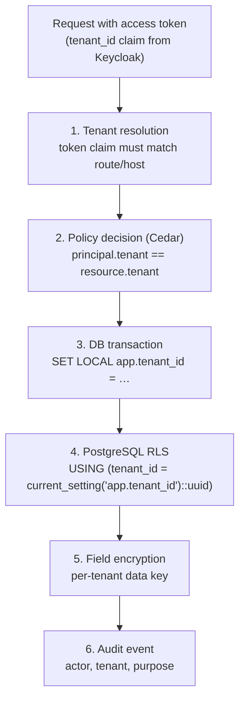

# 4. Multi-Tenant Architecture

| | |
|---|---|
| Decisions | ADR-016 (tenancy model and isolation tiers), ADR-019 (deployment tiers), ADR-003 (RLS), ADR-012 (per-tenant keys) |
| Requirement | One institution = one tenant; isolation; per-tenant configuration and keys; export/exit (Phase 1 §18.1 #3); financial-institution tenants (R-1) |
| Built in Phase 2 | Model and rules only. Tenant tables arrive in Phase 3 (identity-access). The policy spike proves the tenant-isolation rule (cases C04, C05, C15) |

## 4.1 Definitions

| Term | Meaning |
|---|---|
| **Cell** | One deployment of the whole platform in one country (or on one customer's premises). Hard boundary: separate network, databases, keys, backups |
| **Tenant** | One customer institution inside a cell (a bank, a leasing company, a ministry). Every tenant-scoped row carries `tenant_id` |
| **Organisational unit** | A branch, team or department inside a tenant. Used for data scoping (e.g. complaint unit, branch) |
| **Platform tenant** | `civora-platform`: CIVORA's own operators. They have **no** standing access to tenant data |

## 4.2 Isolation tiers (ADR-016)

A tenant chooses a tier by contract. All tiers run the same code.

| Tier | Database | Keys | Compute | When | Price impact |
|---|---|---|---|---|---|
| **T-shared** (default) | Shared clusters; `tenant_id` + **row-level security** + policy checks | Per-tenant data keys (envelope encryption) | Shared | Most institutions; all Government tenants inside a government cell | Base |
| **T-dedicated-db** | Dedicated database (same cluster or dedicated cluster) | Per-tenant keys; optional customer-managed root key | Shared | Banks that require physical data separation | Higher (Phase 1 [19](../phase-1/19-commercial-and-pricing-strategy.md)) |
| **T-dedicated-cell** | Whole cell for one tenant, operated by CIVORA in Tunisia | Tenant's own OpenBao/HSM partition | Dedicated | Large banks; regulator or outsourcing requirements (Law 2016-48 Art. 81 notice) | Highest SaaS |
| **T-customer-hosted** | Cell on the customer's premises, operated by the customer or by CIVORA under contract | Customer's HSM | Customer's | Banks that cannot outsource; government institutions hosting at CNI | Licence + support |

The tier is a field on the tenant record and a deployment choice. Moving a tenant **up** a tier uses the export/import path in §4.6.

## 4.3 Isolation in depth (T-shared)

| Layer | Control | Fails how |
|---|---|---|
| 1 | Tenant comes **only** from the verified token, never from a request body or header | Mismatch → 403, audit event |
| 2 | Every resource decision goes through the policy engine. Cross-tenant access is forbidden except an audited break-glass read (ADR-006 rule F1) | Deny by default |
| 3–4 | The application connects with a role that **cannot bypass RLS** (`NOBYPASSRLS`, not the table owner). `app.tenant_id` is set per transaction (`SET LOCAL`), so pooled connections cannot leak it | No tenant set → zero rows |
| 5 | T1 columns are encrypted with the tenant's data key. A row read under the wrong key does not decrypt | Decryption error, alert |
| 6 | Hash-chained audit records actor, tenant, purpose, object reference | Tamper-evident |

**Test obligations** (Phase 3 onwards; [17](17-technical-validation-strategy.md) §17.5):
- Every repository method gets a cross-tenant negative test.
- A CI test connects as the application role and proves that RLS is on for every tenant-scoped table: a query of `pg_class.relrowsecurity` and `relforcerowsecurity` must find none missing.

## 4.4 Tenant-scoped data and services

| Concern | Rule |
|---|---|
| Configuration | Tenant overrides for flags, rule-pack activation (within regulatory ceilings), taxonomies, templates, branding |
| Rate limits and quotas | Per tenant at the gateway and in BullMQ queues (fair scheduling), so one tenant cannot starve others ([14](14-scalability-and-performance.md)) |
| Object storage | Bucket or prefix per tenant; envelope-encrypted objects; per-tenant policies (ADR-020) |
| Search and reporting | Per-tenant only. **No cross-tenant analytics** (Phase 1 §18.1 #17). Benchmarking only with explicit opt-in and anonymisation |
| Observability | Metrics may carry `tenant_id` labels; logs carry tenant id and request id, never content |
| Support access | CIVORA staff see tenant data only through break-glass: MFA, written justification, time-boxed, read-only, audited, visible to the tenant |

## 4.5 Financial-institution tenants (R-1)

| Need | Architecture |
|---|---|
| Banking secrecy (Law 2016-48 Art. 61) | Tenant isolation in depth; no CIVORA standing access; per-tenant keys; audit export for the bank's own control functions |
| Outsourcing notice to the BCT (Art. 81) | Tiers T-dedicated-cell / T-customer-hosted; documented sub-processor list (all in Tunisia) |
| Bank SSO and MFA | Keycloak identity brokering per tenant (SAML/OIDC); MFA enforced by policy ([06](06-identity-and-access.md)) |
| Regulator reporting (ROGS760, RAA10/20) | Per-tenant reporting from the case engine; rule-pack driven formats (Phase 6) |
| Audit rights | Read-only auditor role; exportable audit chain with verification tool |

## 4.6 Tenant lifecycle

| Step | What happens | Phase |
|---|---|---|
| Provision | Tenant record, Keycloak organisation/IdP link, data key in OpenBao, default pack activation, admin invitation | 3 |
| Configure | Taxonomy, rule-pack deadlines (≤ ceiling), templates, SSO | 3–6 |
| Operate | Normal use; quotas; per-tenant reporting | 6+ |
| Export | Full export (cases, documents, audit chain) in open formats, with checksums | 6 (exit requirement, PRD §12.7) |
| Off-board | Export delivered → retention hold if required → crypto-shredding of the tenant data key → deletion certificate | 6 |
| Move tier | Export → import into the new tier → verification → crypto-shred the old copy | 13+ |
