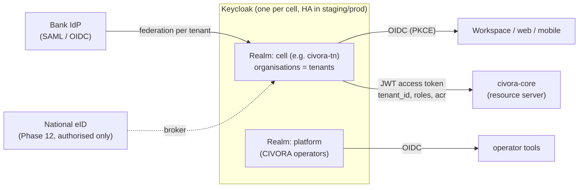

# 6. Identity and Access Management

| | |
|---|---|
| Decisions | ADR-005 (Keycloak broker; passkeys first; SMS OTP fallback only), ADR-006 (Cedar for ABAC), ADR-016 (tenancy) |
| Original items | **O-A2** Keycloak (dev cell); **O-A7** policy-engine spike |
| Built in Phase 2 | Keycloak 26.0 in the dev cell with realm `civora-dev`: AR/FR/EN, brute-force protection, password policy, PKCE public client for the Workspace, bearer-only API client, `tenant_id` claim mapper, synthetic users with random passwords. Cedar policy model with 24 conformance cases |
| Phase 3 update (21 Nov 2026) | The dev cell now runs Keycloak 26.8.1 (pinned) with the citizens and staff realms, a post-import policy and live conformance checks; the dev realm's password grant is denied realm-wide. See [Phase 3 doc 03](../phase-3/03-identity-realms-and-authentication.md) |
| Phase 3 update (21 Nov 2026, eID) | Identity links through the **simulated** national eID: the core verifies the eID's signed answer itself and keeps a keyed digest of the identifier (proofing, not sign-in). Signing in with the eID through the Keycloak broker (§6.2) stays for Phase 12, authorised only. See [Phase 3 doc 06](../phase-3/06-simulated-eid-identity-links.md) |
| Built later | Phase 3: staff SSO, customer OTP, accounts, sessions, tenant admin. Phase 3/12: citizen accounts and eID brokering (authorised only) |

## 6.1 Identity populations

| Population | Authenticates with | Assurance (NIST 800-63-4 / eIDAS) | Phase |
|---|---|---|---|
| Institution staff (handlers, supervisors, admins) | Institution SSO via Keycloak brokering (SAML 2.0 / OIDC). Local accounts only as a fallback | AAL2 minimum; admins and break-glass **AAL3** (FIDO2 hardware keys, Phase 0 §10.3) | 3 |
| Bank customers (status page) | Case reference + one-time code to the contact on file | AAL1 + possession of the reference; rate-limited | 3/6 |
| Citizens (Government track) | Passkeys by default; TOTP; SMS OTP fallback with velocity limits; national eID via broker **only where authorised** | Per service: LoA low/substantial/high with step-up | 3, 12 |
| B2B clients and integrators | OAuth 2.0 client credentials **with mTLS**; per-client scopes and quotas; secrets/keys rotated ≤ 12 months | — | 6, 12 |
| CIVORA operators | Keycloak platform realm, FIDO2 keys, device posture; **no standing tenant-data access** | AAL3 | 3 |
| Workloads | Kubernetes service accounts (token automount off by default); OpenBao Kubernetes auth for secrets | — | 2 (pattern), 3 |

## 6.2 Keycloak topology

| Choice | Decision | Why |
|---|---|---|
| Realm granularity | **One realm per cell**; tenants as Keycloak *organisations* with their own identity-provider links | A realm per tenant does not scale operationally. Organisations give per-tenant IdP brokering and membership |
| Separate operator realm | Yes | Operator identities never mix with tenant identities |
| Tokens | Access token lifetime 5 min; refresh tokens rotated and bound to the client; server-side revocation | Phase 0 §10.3 |
| Claims used by core | `sub`, `tenant_id`, `roles`, `acr` (assurance), `amr` (methods), `auth_time` | Policy inputs |
| Pairwise subjects | For relying parties (Identity division) | Unlinkability (Phase 0 §9.1) |
| Database | Its own database. In staging and production, its own PostgreSQL cluster | Isolation; separate backup policy |
| Theming | AR (default), FR, EN with RTL login pages | ADR-014 |

## 6.3 Authorisation model

Two layers. Coarse roles come from identity; fine-grained decisions come from policies.

| Layer | Mechanism | Examples |
|---|---|---|
| **RBAC** (coarse) | Roles in the token | `case-handler`, `supervisor`, `correspondent`, `tenant-admin`, `auditor`, `customer`, `platform-operator`; citizen, agent under mandate, officer (Government) |
| **ABAC** (fine) | Cedar policies evaluated in-process (ADR-006). Inputs: principal attributes, resource attributes, context (MFA, purpose, consent, break-glass, time) | Tenant isolation; unit scoping; export rights; MFA for configuration; break-glass; T0 purpose-and-consent |
| **Data layer** | PostgreSQL RLS on `tenant_id` | Last line of defence if application code is wrong |

**Policy lifecycle.**
- Policies and their schema are versioned in the repository and validated in CI (strict mode).
- They ship with the conformance table (`spikes/policy-engine/cases.json`, moved to `packages/policies` in Phase 3).
- Policy changes need security review (Phase 0 §10.4).
- A country pack may add policies; it may not remove the platform's `forbid` rules.

**Purpose binding.**
- Every T0/T1 read declares a purpose code. The code is checked by policy, written to the audit event and, on the Government track, shown to the citizen.

**Mandates (Phase 4).**
- Effective permissions are the intersection of the agent's role and the mandate scope.

## 6.4 Break-glass

| Rule | Implementation |
|---|---|
| Who | `platform-operator` role in the platform realm only |
| Conditions | MFA (AAL3) + written justification (ticket or incident reference) + time box. **Read-only** (policy rules P6/F1; spike cases C17–C21) |
| Visibility | Audit event + notification to the tenant's security contact; tenant-visible in the audit export |
| Review | Mandatory review within 72 h [A] (Phase 0 §10.4) |
| T0 (health) | Additionally restricted to the emergency summary dataset (Phase 7) |

## 6.5 Session and token security (web)

- Workspace and web apps use the authorisation code flow with PKCE (S256). No implicit flow and no password grant: the dev realm already sets `directAccessGrantsEnabled=false`.
- Tokens are held by a backend-for-frontend; the browser gets an HttpOnly, Secure, SameSite=strict session cookie. CSRF protection applies to state-changing requests.
- Sensitive actions require re-authentication or step-up (`acr`/`auth_time` checked by policy). Examples: rule-pack changes, exports, user management.
- Idle timeout 30 min; absolute session 8 h for staff (Phase 0 §10.3: max 8 h; the dev realm uses 10 h and will be aligned in Phase 3).

## 6.6 Account lifecycle

| Event | Staff | Customer / citizen |
|---|---|---|
| Joiner | Provisioned from the institution's IdP (JIT on first SSO, or SCIM where available) | Created at first case or registration |
| Mover | Role and unit from IdP groups, mapped per tenant | — |
| Leaver | IdP disables → Keycloak session revoked → access ends at token expiry (≤ 5 min) | Account deletion per retention rules |
| Recovery | Through the institution's IdP | Re-proofing at the original assurance level; **never** knowledge questions (Phase 0 §10.3) |

## 6.7 What Phase 2 validated

- Realm import works on Keycloak 26.0. The OIDC discovery endpoint answers (dev-cell smoke test). Imported synthetic users carry no password in Git; the start-up script sets random ones.
- Keycloak 26 rejects unknown realm attributes (`duplicateEmails` was removed). Realm files are therefore validated by importing them in CI (nightly dev-cell job).
- The policy model expresses the eight access rules in Cedar and in Rego with identical decisions (24/24): [spike README](../../spikes/policy-engine/README.md).
