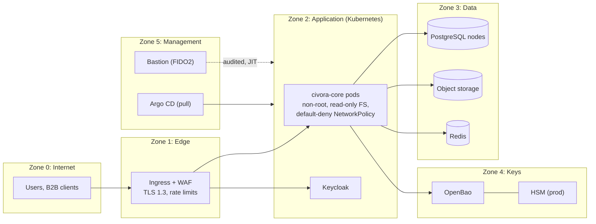

# 7. Security and Privacy Architecture

| | |
|---|---|
| Decisions | ADR-012 (OpenBao + HSM; envelope encryption; per-tenant keys), ADR-027 (supply chain), ADR-018 (classification), ADR-011 (no personal data in logs), ADR-025 (environments and synthetic data) |
| Original items | **O-SEC1** secrets management (§7.4), **O-SEC2** signed builds, **O-SEC3** SBOM (§7.6), **O-SEC4** branch protection, **O-SEC5** 2-reviewer rule (§7.7); **O-D2** threat model ([08](08-threat-model.md)) |
| Baseline unchanged | Phase 0 §10 (classification, controls, crypto, privacy by design, compliance roadmap). This document says how it is implemented |
| Standards | OWASP ASVS v5 L2 for all modules, L3 for identity, consent, health and trust APIs; WCAG 2.2 AA; NIST SP 800-63-4 |

## 7.1 Security zones in a cell

| Rule | Enforcement (built or configured in Phase 2) |
|---|---|
| Only Zone 1 is reachable from the Internet | Ingress only; dev-cell ports bind to 127.0.0.1 |
| Pods run with the restricted Pod Security Standard | Namespace label `enforce=restricted`; chart: UID 10001, read-only root FS, no capabilities, seccomp `RuntimeDefault`. Server-side validation passes; a privileged pod is rejected (negative control) |
| Default-deny network policy | The chart allows only ingress from named namespaces, DNS, PostgreSQL (pods or database-node CIDR) and the OTel collector. An empty allow-list denies all |
| No inbound CI access to clusters | Argo CD **pulls** from Git and the registry (ADR-013) |
| No standing production access | Bastion with FIDO2, just-in-time approval, session recording (Phase 11 hardening) |

## 7.2 Cryptography (Phase 0 §10.5, implemented as)

| Use | Mechanism | Keys |
|---|---|---|
| Transport | TLS 1.3 at the edge (TLS 1.2 strong suites only for legacy partners); mTLS between services inside the cell (service mesh decision deferred until a second service runs — ADR-013 note) | Cell CA in OpenBao PKI |
| Data at rest | Volume encryption on all nodes; PostgreSQL data checksums enabled (`--data-checksums`, verified in the dev cell) | Host-managed |
| T0/T1 fields | AES-256-GCM, envelope encryption: a **data key per tenant** wrapped by OpenBao transit; root in the HSM in production | OpenBao transit `tenant-<id>` keys |
| Blind indexes | HMAC-SHA-256 with a cell secret | OpenBao |
| Signing (audit anchors, documents, credentials) | HSM-held keys; TunTrust certificates where national recognition is needed | Key & signing service (Phase 4) |
| Crypto-shredding | Destroying a tenant's key makes its data unreadable, including in backups | OpenBao key deletion with M-of-N approval |

## 7.3 Privacy by design (Phase 0 §10.6)

| Practice | How it is enforced |
|---|---|
| Minimisation checklist per feature | Pull-request template section; blocking review by the DPO (or counsel until appointed) for T0/T1 |
| No personal data in logs, metrics or traces | Logger writes fixed fields only (timestamp, level, service, context, message); request bodies and headers are never logged. Error responses echo neither the query string, nor headers, nor the body: only the path, as RFC 9457 `instance`; personal identifiers are never allowed in paths ([10](10-api-architecture-and-standards.md)). **Tested:** canary values in query, path, headers, cookies and bodies never reach a log line ([17](17-technical-validation-strategy.md) R27). Traces are tested in the same way (R21). Phase 3 extends the test to every module |
| Synthetic data outside pilot and production | Reserved identifier ranges; CI fitness check; pilot and production refuse the synthetic pack; demo banner flag `platform.synthetic-banner` |
| DPIA for every T0/T1 module before pilot | Template in Phase 3; shared with the tenant and, where required, the INPDP |
| Records of processing | Generated from schema annotations ([05](05-data-architecture-and-governance.md) §5.3) |
| Data-subject rights | Self-service + officer workflow with deadline tracking (Phase 6/13) |
| Citizen Data Charter | No dark patterns, no advertising, no data monetisation (Phase 1 [charter review pack](../phase-1/validation/charter-review-pack.md)) |

## 7.4 Secrets management (O-SEC1)

| Environment | Store | Delivery to workloads | Rotation |
|---|---|---|---|
| Local dev cell | `.env` generated with random values by `dev-cell-up.sh` (file mode 600, git-ignored); OpenBao in dev mode | Environment variables (dev only) | Per `--fresh` run |
| CI | GitHub Actions secrets: **none needed** for build and test. Image signing uses keyless OIDC (no stored key). The CI database password is a disposable, non-secret constant | — | — |
| Staging / pilot / prod | **OpenBao** (HA, auto-unseal via HSM or KMS in the cell) | External Secrets Operator → Kubernetes Secret → **mounted as a file** (`DATABASE_URL_FILE`), never as an env var in the pod spec (chart default) | DB credentials: dynamic, ≤ 24 h leases (Phase 3); B2B secrets ≤ 12 months; data keys yearly or on incident |
| Kubernetes cluster token | Written to the node from OpenBao by the operator; the Ansible role **refuses to run** without it | File `0600` | On rebuild |

**Rules:**
- No secret in Git. gitleaks runs over the full history on every push; the result on 19 Nov 2026 was "no leaks found".
- Secrets are never baked into images. A proxy CA needed at build time is passed as a BuildKit secret mount and is not stored in any layer.
- The application supports `NAME_FILE` for every secret (tested for `DATABASE_URL`).

## 7.5 Application security controls (built)

| Control | Where | Test |
|---|---|---|
| Security headers: `X-Content-Type-Options`, `Referrer-Policy: no-referrer`, `Cache-Control: no-store`, `Cross-Origin-Resource-Policy`; `X-Powered-By` removed | `RequestContextMiddleware`, `app.factory.ts` | e2e test |
| Correlation id: an incoming `X-Request-Id` is accepted only if it matches `^[A-Za-z0-9-]{8,64}$`, otherwise replaced (no header injection) | Middleware | e2e test |
| Errors as RFC 9457 problem details. `title` is the standard reason phrase, never an exception message: the router's 404 message contained the full URL with its query string (defect found and fixed 20 Nov 2026). No stack traces; 5xx logged with request id only | `ProblemDetailsFilter` | e2e + log-privacy test |
| Database failover does not stop the service: a dropped idle connection is logged with a fixed message and replaced. Before the fix (20 Nov 2026) the process exited on the first failover | `DatabaseProbe` | Unit test (fails without the fix) + database suite |
| Database access: migrations as the schema owner, runtime as a `NOSUPERUSER NOBYPASSRLS` account, `verify-full` TLS to `pg-router` | Role `postgresql_ha`, charts | Database suite (R24/R25) |
| Configuration validated at start (`CIVORA_ENV`, `PORT`); fail closed | `app-config.ts` | Unit tests |
| Country pack integrity and environment gate | `country-config.module.ts` | Unit + e2e; manual check: `CIVORA_ENV=prod` refuses to start |
| Metrics not in the public API contract | `@ApiExcludeController` | e2e test |
| Code owned by root and not writable by the process; runtime has no npm, npx, corepack or yarn | Dockerfile | Verified (`touch` denied; Trivy) |

## 7.6 Supply chain (O-SEC2, O-SEC3; ADR-027)

| Gate | Tool | Phase 2 result |
|---|---|---|
| Pinned dependencies with integrity | `pnpm-lock.yaml`, `--frozen-lockfile`; exact versions | In place. Example caught: `@cedar-policy/cedar-wasm@4.14.1` was published empty; 4.14.0 pinned instead |
| No install scripts | `ignoredBuiltDependencies` (`@nestjs/core`, `@scarf/scarf`) | In place |
| Dependency audit | `pnpm audit --prod --audit-level high` | 0 high/critical (3 moderate) |
| Container vulnerabilities | Trivy (fixable HIGH/CRITICAL fail the build) | **21 → 0** after upgrades (NestJS 11.2.8, Swagger 11.4.8, multer override) and removing npm from the runtime |
| SAST | CodeQL `security-extended` | Configured (runs on GitHub) |
| Secrets | gitleaks full history | No leaks |
| IaC | Checkov (Kubernetes, Helm, Dockerfile, Terraform, Ansible, GitHub Actions) | Dockerfile 31/31; workflows 36/36. Chart findings fixed or accepted with reasons ([17](17-technical-validation-strategy.md) §17.4) |
| SBOM | Syft → CycloneDX JSON | 878 components for `civora-core:dev` |
| Signing and provenance | cosign keyless + SBOM attestation + SLSA build provenance (`actions/attest-build-provenance`) | Configured for `main` (needs GitHub to run) |
| Third-party actions | Pinned to full commit SHAs (resolved 19 Nov 2026) | In place |
| Admission: allowed registries + digest pins | Built-in Kubernetes ValidatingAdmissionPolicy ([infra/k8s/policies](../../infra/k8s/policies/image-admission.yaml)); per-cell registry list in a ConfigMap; missing list = deny | **Built and tested 20 Nov 2026** on a Kubernetes 1.33 API server: 10 cases, including a look-alike registry prefix and an unpinned CronJob (R28) |
| Admission: signature verification (cosign) | Sigstore policy-controller + `ClusterImagePolicy` requiring the **CIVORA release key** (verifiable offline; ADR-027 proposed revision); images matching no policy are refused | **Built 20 Nov 2026** (R36): values meet restricted Pod Security (chart defaults do not — control); runtime test on GitHub runners. Remaining: release-key ceremony |

## 7.7 Repository protection (O-SEC4, O-SEC5)

These are GitHub settings. Only a repository administrator can apply them; **this is a founder action**.

| Setting (branch `main`) | Value |
|---|---|
| Require a pull request before merging | On |
| Required approvals | **2** (O-SEC5); dismiss stale approvals; require review from code owners |
| Required status checks | `build-test`, `secret-scan`, `codeql`, `iac`, `policy-engine-spike`, `image` |
| Require signed commits | On |
| Require linear history; block force pushes and deletions | On |
| Include administrators | On |

**Limitation.**
- With one engineer, two approvals are impossible.
- Until a second engineer joins (founder action 11 in the Phase 1 pack), the founder must either record a **temporary waiver**, or have an external reviewer approve changes to `infra/`, `migrations/` and policies.
- This is listed as a risk in the [readiness report](phase-2-readiness-report.md).

## 7.8 Monitoring, detection and incident response

- In-cell SIEM from Phase 11 (Wazuh/OpenSearch, Phase 0 §10.9).
- The audit stream and Keycloak events are designed so that detection rules can be added without schema changes:
  - mass access;
  - off-hours T0 access;
  - policy-deny bursts;
  - admin actions;
  - key-usage anomalies.
- Incident notification paths (Phase 0 §10.9): the tenant (contract), **ANCS** (Decree-law 2023-17), INPDP where personal data is affected [A — counsel], and affected people where appropriate.

## 7.9 Compliance path (Phase 0 §10.10, unchanged)

| Milestone | Status |
|---|---|
| ANCS-certified audit before the first pilot with real data | Quotes requested in the Phase 1 founder action pack (action 10). **Not engaged** |
| Hosting on a labelled cloud or CNI from the first pilot | Provider not selected (E-07) |
| External review of this threat model (O-AC3) | **Not engaged** |
| ISO 27001 (month ~18–24), ISO 27701 (~24–30) | Not started |
