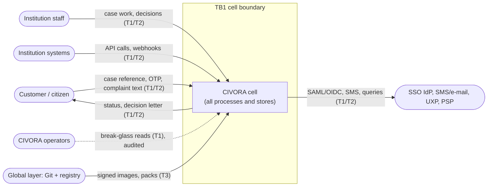
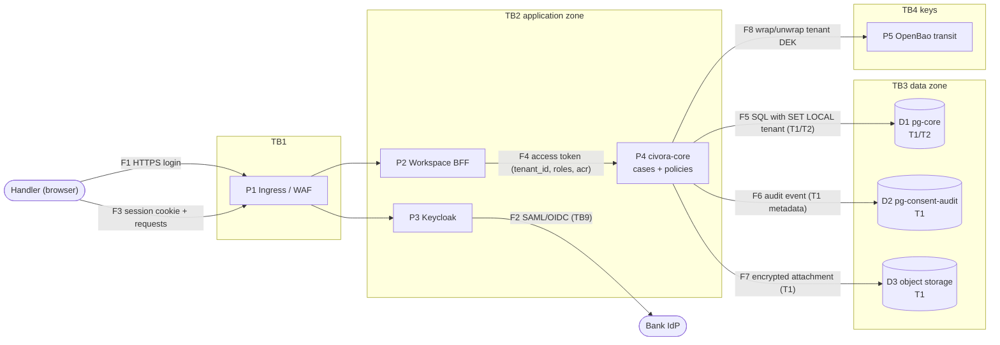
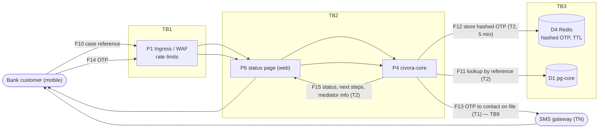
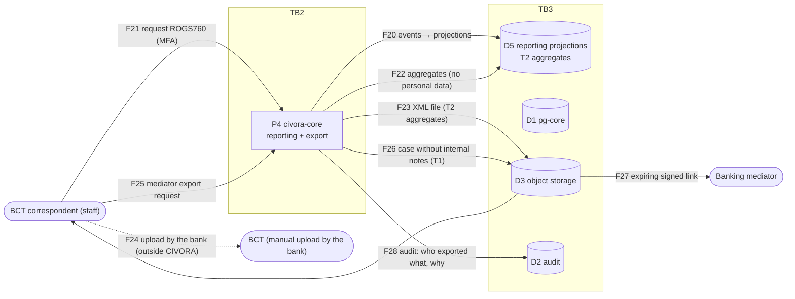
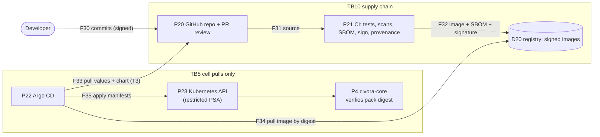
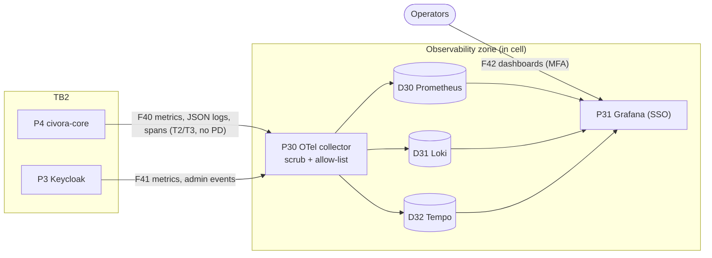
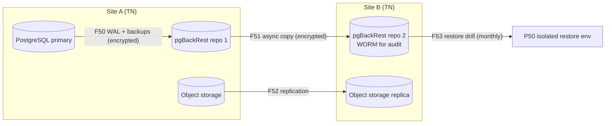
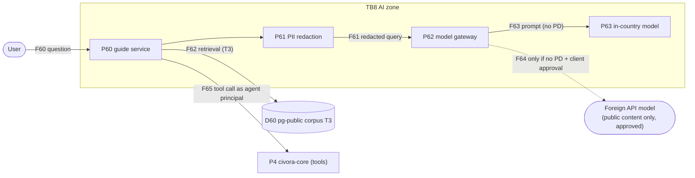
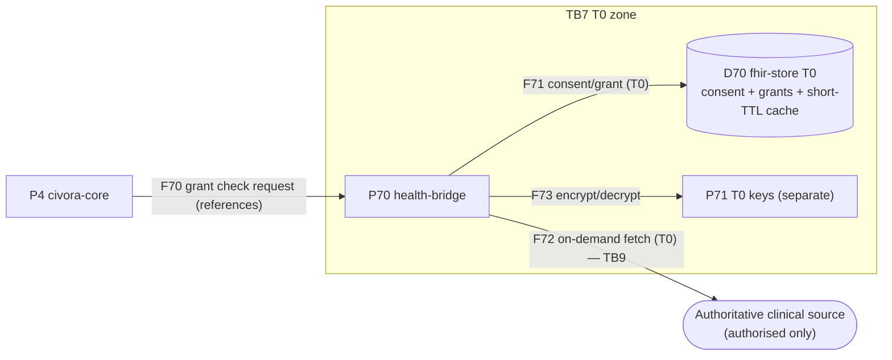

# 9. Data-Flow Diagrams

| | |
|---|---|
| Purpose | Show where data moves, across which trust boundaries, at which tier. These diagrams are the basis of the STRIDE analysis in [08](08-threat-model.md) |
| Notation | Rectangles = processes; cylinders = stores; ovals/rounded = external entities; dashed subgraph borders = trust boundaries **TB1–TB10**. Flow labels give the data and its tier (T0–T3, Phase 0 §10.1). "Ph.N" = built in roadmap phase N |
| Status | Phase 2 design. Only DFD-4, the platform parts of DFD-5, and the dev-cell versions of the stores exist today |

## 9.1 Trust boundaries

| ID | Boundary | Between |
|---|---|---|
| TB1 | Internet ↔ cell edge | Users, B2B clients ↔ ingress/WAF |
| TB2 | Edge ↔ application | Ingress ↔ `civora-core`, Keycloak |
| TB3 | Application ↔ data | `civora-core` ↔ PostgreSQL, Redis, object storage |
| TB4 | Application ↔ keys | `civora-core` ↔ OpenBao / HSM |
| TB5 | Cell ↔ global layer | Argo CD in the cell ↔ Git / registry (pull only) |
| TB6 | Tenant ↔ tenant | Logical boundary inside shared stores (RLS, keys, policies) |
| TB7 | Core ↔ health-bridge | T0 zone (Phase 7) |
| TB8 | Core ↔ AI guide; guide ↔ model | AI zone (Phase 10) |
| TB9 | Adapters ↔ external systems | SSO IdPs, SMS/e-mail gateways, UXP (via member), PSPs |
| TB10 | Developer / CI ↔ repository and registry | Supply chain |

## 9.2 DFD-0: context

## 9.3 DFD-1: staff sign-in and case handling (Workspace RF, Ph.3–6)

| Flow | Data | Tier | Protection |
|---|---|---|---|
| F1–F2 | Credentials stay at the IdP; assertions to Keycloak | T1 | TLS 1.3; SAML signed assertions / OIDC PKCE; MFA by policy |
| F3 | Session cookie (HttpOnly, Secure, SameSite=strict) | T2 | TLS; CSRF tokens |
| F4 | JWT (5 min) | T2 | Signature, audience, issuer checks; tenant from token only |
| F5 | Case rows; T1 columns encrypted | T1/T2 | RLS; least-privilege role; TLS to the database |
| F6 | Actor, action, object reference, purpose, hash | T1 | Append-only role; hash chain |
| F7 | Attachment ciphertext | T1 | Envelope encryption; per-tenant prefix; object lock for evidence |
| F8 | Data-key wrap/unwrap | — | OpenBao policy per tenant key; audit device on |

## 9.4 DFD-2: customer status page with one-time code (Ph.3/6)

Key properties:
- The response never confirms whether a reference exists before the OTP step (anti-enumeration).
- OTP attempts are limited per reference and per IP.
- SMS volume is limited per tenant (SMS-pumping defence).
- The status view carries no internal notes (FR-26).

## 9.5 DFD-3: regulatory statement and mediator export (Ph.6)

## 9.6 DFD-4: release and configuration supply chain (built in Phase 2)

## 9.7 DFD-5: observability (no personal data)

## 9.8 DFD-6: backup and recovery

## 9.9 DFD-7: AI guide (Ph.10, design only)

## 9.10 DFD-8: health bridge (Ph.7, design only)

## 9.11 Flow-to-threat cross-reference

Each flow and store above appears in the threat register ([08](08-threat-model.md) §8.5) under its element id: P*, D*, F*, TB*.
