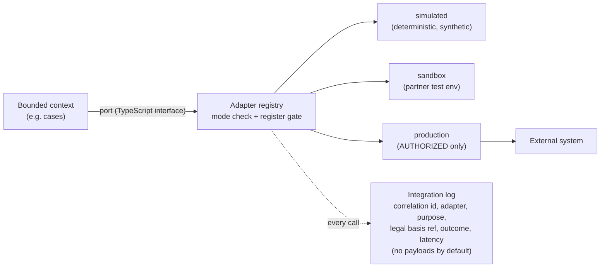

# 11. Integration Architecture

| | |
|---|---|
| Decisions | ADR-028 (adapter framework and six integration classes), ADR-008 (outbox + BullMQ), ADR-015 (API standards) |
| Inputs | Phase 0 §8.7 (adapter framework, UXP rules, resilience); [integration status register](../phase-0/integration-status-register.md) (P1-D6 six classes); Phase 1 capability #14 |
| Fact | **No integration is live or authorised.** Register: 0 completed, 0 in progress. Phase 2 changes no integration status |
| Built in Phase 2 | The `integrations` bounded context (empty) and the locked flag `integrations.production-adapters=false`, which tenants cannot override (tested) |

## 11.1 Integration classes (P1-D6)

| Class | Meaning | Allowed adapter modes |
|---|---|---|
| 1 | Verified official integration (agreement in place) | `simulated`, `sandbox`, `production` |
| 2 | Authorised partner integration | `simulated`, `sandbox`, `production` |
| 3 | Technically possible, **not authorised** | `simulated` only (`sandbox` only with the owner's written test access) |
| 4 | Independent prototype | `simulated` only |
| 5 | Future opportunity | none (interface may exist) |
| 6 | Not currently feasible | none |

**Rule (ADR-028).** An adapter may run in `production` mode only if all three hold:
1. the register entry is `AUTHORIZED`, with an agreement reference;
2. the cell's platform flag `integrations.production-adapters` is on;
3. the tenant's activation is recorded.

The adapter registry checks all three at start-up and on every enablement. Failing any one means the adapter refuses to start in production mode.

## 11.2 Adapter framework

| Port (Phase 0 §8.7) | First consumer | Simulated in |
|---|---|---|
| `IdentityProvider` | Staff SSO brokering (Keycloak) | 3 |
| `MessagingChannel` | SMS and e-mail notifications (TN gateways) | 3 |
| `StatusFeed` | Case status to institution systems / webhooks | 6 |
| `RegistryQuery` | Government registries via UXP (member's security server) | 12 |
| `PaymentProvider` | Payment intents (licensed PSPs) | 8 |
| `CredentialIssuer` | Credentials, e-signature (TunTrust) | 4 |
| `CoreBankingRead` (Phase 1 addition) | Optional account lookup for Workspace RF | 6 (class 3: simulated only) |
| `RegulatoryReport` (Phase 1 addition) | ROGS760 / RAA10/20 file generation (manual upload by the bank; no BCT system integration) | 6 |

**Adapter contract:**
- Each adapter implements the port.
- Each adapter has a **contract test suite** shared by all three modes. The simulated adapter passes the same tests as the production one.
- Adapters live in `services/core/src/modules/integrations/adapters/<port>/<provider>`. Other modules see only the port through `public-api.ts`.

## 11.3 National interoperability (UXP / X-Road)

These rules are unchanged from Phase 0 §8.7:
- CIVORA **never operates a security server on behalf of the state**. In a deployment for member institution M, M's security server signs and logs requests.
- Each call carries the purpose, the legal-basis reference and an end-user reference, for audit on both sides.
- The citizen sees "the source registry is unavailable" (degraded mode). Stale data is never presented as current.

## 11.4 Resilience

| Pattern | Setting (defaults; per adapter override) |
|---|---|
| Timeouts | Connect 2 s, total 10 s (interactive) / 60 s (batch) |
| Retries | Only for idempotent operations; exponential back-off with jitter; max 3 (interactive) / 8 (batch) |
| Circuit breaker | Open after 50% failures over 20 calls; half-open after 30 s |
| Idempotency | Idempotency key on every outbound create; stored with the outbox record |
| Asynchronous work | Transactional outbox in the module schema → relay → BullMQ queue; consumers idempotent; dead-letter queue with an operator view (ADR-008) |
| Bulkheads | Per-adapter and per-tenant concurrency limits, so one slow partner or tenant cannot exhaust workers |

## 11.5 Events

- Domain events (Phase 0 §8.8) carry **references, not personal payloads**. Examples: `CaseSubmitted`, `CaseStatusChanged`, `DeadlineBreached`, `ConsentGranted`, `PaymentSucceeded`.
- Event envelope:

  | Field | Content |
  |---|---|
  | `id` | UUIDv7 |
  | `type`, `version` | Event name and schema version |
  | `tenantId` | Owning tenant |
  | `occurredAt` | Timestamp |
  | `correlationId` | Request correlation |
  | `subjectRef` | Object reference |
  | `data` | Minimal, schema-validated payload |

- Schemas are versioned with the module. A consumer must tolerate unknown fields.
- The broker can be swapped (NATS JetStream or Kafka) behind the outbox relay interface when a §8.11 trigger is met (ADR-008).

## 11.6 Outbound webhooks to tenants

Webhooks follow the standards in [10](10-api-architecture-and-standards.md) §10.3:
- signed;
- replay window;
- retries, then dead-letter;
- per-tenant subscriptions;
- secrets rotated.

Payloads carry references and status; the receiver fetches details through the authenticated API.

## 11.7 What is explicitly not assumed

- No access to BCT systems. Regulatory statements are files the institution submits itself.
- No core-banking access (class 3). Simulated only, until a bank authorises it in writing.
- No national eID, Mobile ID or e-signature integration (class 3 → 2 needs formal authorisation).
- No UXP membership. CIVORA can only act through a member institution's security server.
