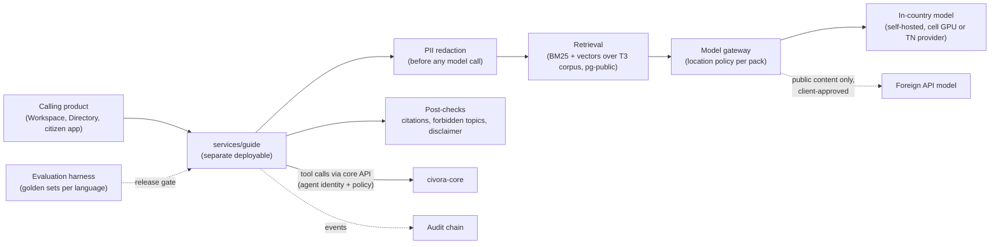

# 12. AI and Agent Infrastructure

| | |
|---|---|
| Decisions | ADR-010 (RAG-only assistant with citation enforcement; model gateway with location policy) and ADR-026 (agent runtime: tools, permissions, human approval, evaluation) |
| Hard constraints | **No AI components before Phase 10** (Phase 1 §18.3). D10: in-country models for any personal data; foreign API models only for public content with no personal data, and only with the client's approval. P1-D14 (Workspace AI inside Phase 10) is **pending** |
| Built in Phase 2 | **Nothing executable.** `services/guide` is an empty placeholder. This document fixes the boundaries now, so earlier phases do not block or contradict them |
| Division | E — AI (incubate) |

## 12.1 Why design now and build later

Three things are cheap to get right now and expensive to retrofit:
- **Data boundaries.** Where AI may read data, and through what.
- **Identity of the agent.** Every AI action must be attributable like a human action.
- **Audit and evaluation hooks.** These must use the same audit chain and the same policy engine as the rest of the platform.

Everything else (models, prompts, vector indexes, tools) is built in Phase 10.

## 12.2 Target architecture (Phase 10)

## 12.3 Model gateway and location policy (ADR-010)

| Data in the prompt | Allowed model location (D10, Phase 0 §8.6) | Enforcement |
|---|---|---|
| Public content + an anonymised query | Foreign API model **only if** the contracting institution approves and the redaction step found no personal data. Counsel to confirm INPDP formalities | The gateway refuses a foreign route when the redactor flags anything or the tenant flag is off |
| Any personal data (including Workspace document processing) | **In-country only** | The route table comes from the country pack; foreign routes are absent from pilot and production packs unless approved |
| T0 health data | Not in any AI flow until the Phase 7 legal gates are met | Policy `forbid` |

Other gateway responsibilities:
- per-tenant quotas and cost accounting;
- model and version pinning per release;
- prompt templates stored as versioned configuration;
- request logs with no personal data (hashes and metadata only).

## 12.4 Agent runtime rules (ADR-026)

| Rule | Mechanism |
|---|---|
| **An agent has its own identity** | Service principal per agent type per tenant (`agent:<name>@<tenant>`). The human on whose behalf it acts is recorded as `onBehalfOf` |
| **Least privilege by tool** | Each tool is a call to a public core API, authorised by Cedar with `principal is Agent`. Agents get read tools by default. Write tools need an explicit policy and a human approval step |
| **Never decides rights** | Policies forbid agent principals from issuing decisions, deadlines, eligibility or refusals. An agent may draft; a human signs (Phase 0 §8.6 "Never" list; Division E rules) |
| **Human-in-the-loop** | Drafts go to a review queue. Acceptance, edit or rejection is recorded in the audit chain and feeds evaluation |
| **No direct database access** | The guide service has no database credentials for `pg-core`. It reads only `pg-public` (T3 corpus) and calls core APIs |
| **Prompt-injection containment** | Retrieved and uploaded content is data, never instructions. Tool calls are validated against JSON schemas. A tool output cannot trigger another write tool without human approval. Test suites per release (Phase 0 §10.7) |
| **Kill switch** | Feature flags per tenant and per agent (`ai.<agent>.enabled`), locked off by default in pilot packs |

## 12.5 Evaluation and release gates (Phase 0 §8.6, unchanged)

- A golden set of **≥ 500 questions per language**: MSA, Derja-Arabic, Arabizi, FR, EN.
- Factual accuracy against sources **≥ 95%**; citation precision; refusal correctness; toxicity and bias; latency on 3G.
- Document processing (if P1-D3 or P1-D14 brings it in) adds:
  - field-level precision and recall per document type on **synthetic** and authorised samples;
  - mandatory human review below a confidence threshold.

## 12.6 Infrastructure implications to reserve now

| Item | Reserved in Phase 2 | Decided in |
|---|---|---|
| GPU capacity in Tunisia | Node role `gpu` in the cell module's vocabulary; Kubernetes node labels and taints pattern | Phase 10, after hosting selection (E-07) [U — TN GPU availability] |
| Vector search | pgvector on `pg-public` (T3 only) | Phase 10 |
| Corpus provenance | The data inventory rows DI-37 to DI-39 define the fields | Phase 5 (Directory) / 10 |
| Policies | Cedar entity type `Agent` planned; the conformance table will get agent cases | Phase 10 |

## 12.7 Not in scope

- Training models on citizens' or customers' data.
- Autonomous agents that act without a human for anything that affects rights, money or deadlines.
- Any AI component in Phases 2–9 (non-goal).
