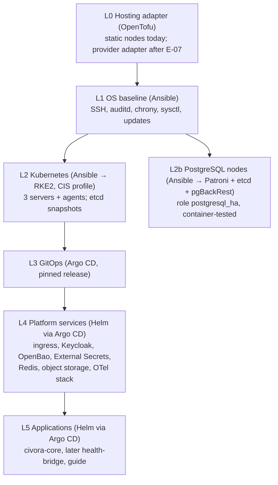
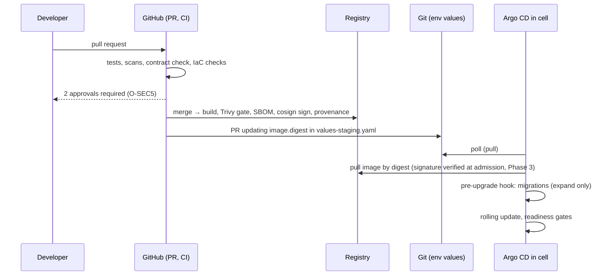

# 13. Cloud and Deployment Architecture

| | |
|---|---|
| Decisions | ADR-004 (country cells), ADR-013 (Kubernetes RKE2/k3s, Helm, OpenTofu, Ansible, Argo CD), ADR-019 (deployment tiers incl. customer-hosted), ADR-025 (environments), ADR-029 (residency, backup, DR) |
| Constraints | D9 hosting policy; R-2 on-premises deployability; R-5 Tunisian hosting; no hosting provider contracted (E-07 open) |
| Built in Phase 2 | Compose dev cell; Helm chart; OpenTofu cell module + static hosting adapter; Ansible baseline + RKE2 + Argo CD bootstrap; Argo CD project/application; validation scripts |

## 13.1 Environments (ADR-025; Phase 0 §8.10)

| Environment | Purpose | Data | Hosting | Status |
|---|---|---|---|---|
| `dev` (local) | Engineering | **Synthetic only** | Developer machine (Docker Compose) | **Built**; from scratch in 82 s, 9/9 checks |
| `ci` | Build, test, scan | Synthetic only | GitHub-hosted runners | **Configured** (runs once pushed to GitHub with Actions enabled) |
| `staging-tn` | Integration, security testing, demos | Synthetic only | Any cloud (D9), preferably the target Tunisian host | **IaC written, not provisioned** (no provider) |
| `pilot-tn` | Authorised pilot | Real data, authorised scope only | CNI or labelled N-Cloud/G-Cloud host in Tunisia, or customer premises | Not before Phase 13 and the legal gates |
| `prod-tn` | Production | Real | As pilot, two in-country sites | Not before Phase 13+ |

## 13.2 Deployment tiers (ADR-019; R-2)

| Tier | Operated by | Where | Release channel | Notes |
|---|---|---|---|---|
| 1. Shared cell | CIVORA | Labelled Tunisian host | Argo CD auto-sync for staging; manual sync with two approvals for production | Default |
| 2. Shared cell, dedicated DB | CIVORA | Same | Same | Tenant isolation tier `T-dedicated-db` |
| 3. Dedicated cell | CIVORA | Labelled host, tenant-specific | Tenant-scheduled maintenance windows | For large banks |
| 4. Customer-hosted cell | Customer, or CIVORA under contract | Customer premises or CNI | **Air-gapped bundle**: images, Helm chart, country pack, SBOMs, signatures, checksums | For banks that cannot outsource (Law 2016-48 Art. 81 outcome) and for government at CNI |

**What makes tier 4 possible (designed and partly tested now):**
- **No runtime dependency outside the cell.** Licences are offline, telemetry is opt-in, and there is no SaaS API.
- **Air-gapped install path.** The k3s rehearsal script preloads every image from a tarball. The RKE2 role supports `rke2_airgap_dir`. The Argo CD manifest can be mirrored.
- **Bring-your-own components.** The design accepts the customer's PostgreSQL (via `databaseCidrs`), the customer's IdP (Keycloak brokering), the customer's HSM (OpenBao seal) and the customer's object storage (S3 API).
- **TLS-inspecting proxies.** Builds and installs accept a proxy CA without baking it into images.

## 13.3 Layers of a cell

| Layer | Artefact | Validated how (Phase 2) |
|---|---|---|
| L0 | `infra/tofu/modules/{cell,hosting-static}`, `envs/staging-tn` | `tofu validate` and `plan`/`apply` offline. Residency precondition rejects a node in another country (negative test) |
| L1–L3 | `infra/ansible` (`site.yml`, roles `base_hardening`, `rke2`, `argocd_bootstrap`) | `--syntax-check`; `ansible-lint` production profile: 0 failures. **Not run against real hosts** (none exist) |
| L2b | Role `postgresql_ha` (PostgreSQL 16, Patroni, etcd, pgBackRest, restore drill) | Integration test on three systemd containers: replication, failover, backup, restore drill, idempotence ([17](17-technical-validation-strategy.md) §17.2) |
| L4 | Platform charts (upstream, pinned) listed in [16](16-infrastructure-plan.md) §16.3 | Same images run in the dev cell |
| L5 | `infra/helm/civora-core` | `helm lint`; server-side dry-run on Kubernetes 1.33 under restricted Pod Security; Checkov |
| GitOps objects | `infra/argocd/project.yaml`, `apps/staging-tn.yaml` | Server-side dry-run against the Argo CD v3.4.13 CRD schemas |

## 13.4 Kubernetes distribution (ADR-013)

| Use | Distribution | Why |
|---|---|---|
| Staging, pilot, production, customer-hosted | **RKE2** with the CIS profile, `secrets-encryption`, `protect-kernel-defaults` | Hardened defaults, CIS benchmark profile, air-gap support, SELinux support |
| Local rehearsal, very small edge cells | **k3s** | Lightweight; same Kubernetes API (1.33) |

Both are in Phase 0's approved list ("k3s/RKE2"). Using both by environment is a refinement, not a replacement.

## 13.5 Release flow

- **Staging** syncs automatically. **Production** syncs manually with two approvals ([16](16-infrastructure-plan.md) §16.6).
- **Image signature verification at admission** (Sigstore policy controller or Kyverno) is added in Phase 3, before pilot. Until then, digests in Git are the control.
- **Rollback** means reverting the values commit. Migrations are expand-only, so the previous version keeps working (ADR-024).

## 13.6 Hosting provider selection criteria (input to E-07)

| Criterion | Requirement |
|---|---|
| Label | N-Cloud/G-Cloud labelled (or CNI) for pilot and production (D9; Circular 5/2026) |
| Location | All data centres, backups and support staff with data access in Tunisia |
| Compute | VMs with ≥ 8 vCPU / 32 GB, API or portal provisioning; anti-affinity across ≥ 2 zones or rooms; GPU option (Phase 10) [U] |
| Storage | Block storage with snapshots; S3-compatible object storage with object lock, or capacity to run it |
| Network | Private networks, firewall rules, a public IP with DDoS protection from the operator |
| Two sites | A second in-country site for DR (RPO ≤ 15 min, RTO ≤ 4 h) |
| HSM | HSM service, or rack space for a customer HSM (production signing keys) |
| Contract | Processor terms under Law 2004-63; audit rights; incident notification; exit assistance |

Quote requests are already prepared: [Phase 1 quote-requests.md](../phase-1/validation/quote-requests.md) §1.3.
