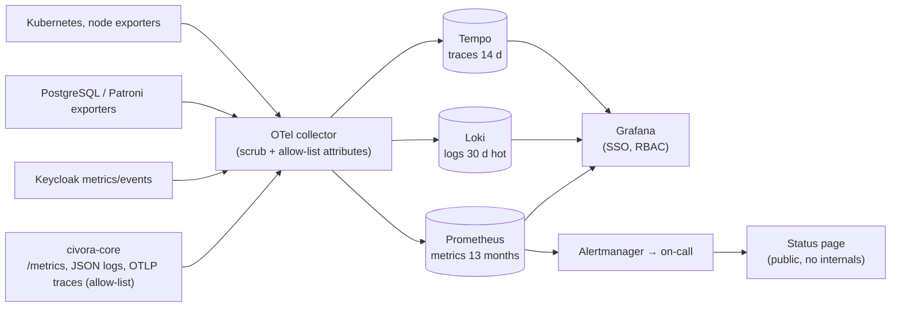

# 15. Observability, Backup and Disaster Recovery

| | |
|---|---|
| Decisions | ADR-011 (self-hosted observability; no personal data in logs), ADR-029 (backup, DR, residency), ADR-003 (PostgreSQL operations) |
| Original item | **O-A6** observability stack |
| Targets | RPO ≤ 15 min, RTO ≤ 4 h (pilot; PRD §12.7, Phase 0 §8.10); two in-country sites in production; monthly restore drill; quarterly DR test (Phase 0 §10.11) |
| Built in Phase 2 | OTel collector + Prometheus + Loki + Tempo + Grafana (`grafana/otel-lgtm` 0.11.0) in the dev cell, login required; `civora-core` exposes Prometheus metrics (`civora_core_*`) and writes structured JSON logs; health and readiness probes |
| Built 19 Nov 2026 | **Tracing** in `civora-core` (OpenTelemetry 3.0: HTTP, Express, NestJS, pg) exported through an attribute allow-list; e2e scrubbing test; dev-cell check that traces reach Tempo without request data. **Backups** as code: role `postgresql_ha` (pgBackRest TLS repository, timers, restore drill) tested on containers |
| Not yet built | Alerting rules; status page; backups on real database nodes (need a provider) |

## 15.1 Observability architecture (per cell, in-country)

| Signal | Content rule | Retention [A] |
|---|---|---|
| Metrics | Counters and histograms; labels limited to service, route template, status class, tenant id. **No user ids, no free text** | 13 months |
| Logs | Fixed JSON fields: `ts`, `level`, `service`, `context`, `msg`, `requestId`, `tenantId`. **Never** request bodies, headers, tokens, identifiers or content. The skeleton logger already writes only fixed fields | 30 days hot, 1 year archive (in-country) |
| Traces | Span names from route templates; attribute allow-list in the collector drops everything else | 14 days |
| Audit | **Not** an observability signal. It goes to `pg-consent-audit` (hash chain), never to Loki | ≥ 5 years |

**Personal-data guard.**
- The collector drops unknown attributes, and a scrubber processor masks patterns: CIN, phone, e-mail, IBAN/RIB.
- From Phase 3, a CI test sends synthetic requests containing reserved-range identifiers and asserts that none appears in the logs, traces or metrics captured by a test collector.

## 15.2 Alerts (first set, Phase 3)

| Alert | Condition | Severity |
|---|---|---|
| API availability burn | 1 h burn rate > 14× (99.5% objective) | Page |
| Latency | p95 > 1.5 s for 15 min | Page |
| Readiness | `/health/ready` failing on > 50% of pods for 5 min | Page |
| Database | Replication lag > 30 s; free disk < 15%; WAL archive failing | Page |
| Backup | No successful pgBackRest backup in 26 h; WAL gap > 15 min (RPO at risk) | Page |
| Queue | Oldest job age > 5 min | Ticket → page if > 30 min |
| Security | Policy-deny burst, break-glass use, admin role change, key usage anomaly | Security on-call |
| Certificates | Expiry < 21 days | Ticket |
| Regulatory deadlines | Cases with `due < now + 2 days` and no owner | Tenant notification (product feature, Phase 6) |

## 15.3 Backup (ADR-029; Phase 0 §9.9)

| Data | Method | Schedule | Copies | Encryption |
|---|---|---|---|---|
| PostgreSQL (`pg-core`, `pg-public`, `pg-consent-audit`, Keycloak DB) | **pgBackRest**: full weekly, differential daily, continuous WAL archiving (PITR) | WAL every ≤ 60 s or 16 MB | Repository 1 on the backup node (site A); repository 2 at the second in-country site | pgBackRest repository encryption; keys separate from production keys |
| `pg-consent-audit` | As above + **WORM-style** retention on repository 2 | Same | Same | Same |
| Object storage | Bucket versioning; object lock on evidence buckets; replication to site B | Continuous | 2 | Envelope encryption (per-tenant keys) |
| OpenBao | Raft snapshots | Hourly | 2 sites | Snapshots encrypted; unseal keys under M-of-N |
| Redis | Not backed up as a system of record (queues are rebuilt from the outbox; sessions expire) | — | — | — |
| Kubernetes state | etcd snapshots (RKE2 `etcd-snapshot-schedule-cron` every 6 h, 28 retained — in the Ansible template) + GitOps (Git is the source of truth) | 6 h | 2 | — |
| Audit-chain anchors | Daily signed chain head stored outside the cluster (and optionally time-stamped by a qualified service) | Daily | 2 | Signed (HSM) |

**Residency.** Both backup sites are in Tunisia. The OpenTofu cell module rejects nodes outside the country and requires the backup node to be in a different zone from every database node (tested).

## 15.4 Recovery objectives and strategy

| Scenario | Strategy | RPO | RTO |
|---|---|---|---|
| Pod or node failure | Kubernetes rescheduling; Patroni automatic failover | 0 (synchronous replica) – 1 min | < 5 min |
| Data corruption or human error | pgBackRest PITR to a point before the event, into a new cluster; tenant-scoped repair by export/import | ≤ 15 min | ≤ 4 h |
| Loss of site A | Restore at site B from repository 2 + object-storage replica; Argo CD redeploys from Git; DNS switch | ≤ 15 min | ≤ 4 h |
| Ransomware or compromised credentials | WORM backups, offline unseal keys, rebuild from IaC + restore; key rotation | ≤ 15 min | ≤ 24 h (declared disaster) [A] |
| Tenant asks for its data back (exit) | Tenant export (cases, documents, audit chain + verification tool) | — | Per contract |

## 15.5 Drills and evidence

| Drill | Frequency | Evidence kept | Pass criteria |
|---|---|---|---|
| Restore drill (Phase 0 §9.9) | **Monthly** | Restore log, checksums, row counts, smoke-test output, time taken | Restore + smoke test within RTO; checksums match |
| DR failover (one cell) | **Quarterly** | Timeline, gaps, actions | RPO/RTO met |
| Audit-chain verification | Weekly, automated | Verifier output | No break; anchors match |
| Deploy from scratch (O-T3) | Nightly (CI) and before each release | Timed job summary | Smoke tests pass; time trend recorded |

"A backup is only verified once restored" (Phase 0 §9.9). The first restore drill is a gate for the first pilot.

## 15.6 Phase 2 status of this design

| Element | Status |
|---|---|
| Observability stack | Running in the dev cell; Grafana requires login (smoke test) |
| Application metrics and logs | Built and tested (`/metrics` exposed; e2e test) |
| Tracing in the application | **Built and tested** (allow-list exporter; e2e scrubbing test; spans reach Tempo in the dev cell) |
| Backups | **Role written and tested on systemd containers**: encrypted repository (unreadable without the passphrase — tested), WAL archiving, weekly full + daily differential timers, restore drill with checksum verification, **point-in-time restore**, **repository 2 at a second site** with its own key (tested 20 Nov 2026). Real database nodes need a hosting provider |
| Disaster recovery (loss of site A) | **Rehearsed on containers** (nightly on GitHub): new cluster built at site B from repository 2 by the role; data lost = last 16 s; writes accepted again 85 s after the loss ([17](17-technical-validation-strategy.md) R32; [runbook](runbooks/database-operations.md) §8) |
| Monitoring stack | kube-prometheus-stack, Loki and Tempo as Argo CD apps with pinned chart versions. The in-cluster node exporter is disabled because it needs privileged pods; host metrics come from the node exporter installed by Ansible over TLS. Infrastructure alerts from §15.2 written and unit-tested (R35); application alerts remain Phase 3 |
| Database failover as the application sees it | Through `pg-router`: no acknowledged write lost; longest write gap 26.7 s (2 servers) / 39.0 s (3 servers); application process survives (R25, R26) |
| etcd snapshots | In the RKE2 configuration template |
| Drills | Restore-drill script in the role (`civora-restore-drill`, latest or point in time); site-loss DR rehearsal (`dr.sh`); procedures in the [database runbook](runbooks/database-operations.md); first drills on real hosts after provider selection |
