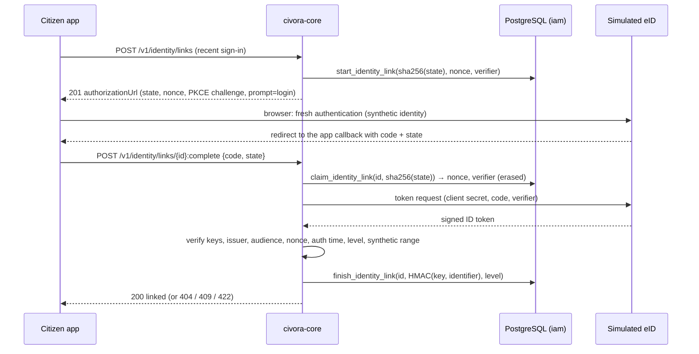

# 06 — Simulated national eID and identity links (Phase 3, week 3, part 3)

| | |
|---|---|
| Specification items | P3-D4 simulated national-eID adapter · P3-API6 `POST /v1/identity/links` (eID link, simulated) · P3-DB4 `iam.identity_claim` |
| Decisions applied | ADR-028 (adapter framework, integration classes), ADR-005 (eID only where authorised), ADR-011 (no personal data in logs), ADR-016 (person from the token only), ADR-025 (synthetic data) |
| Integration register | I-01 national eID / Mobile ID: class 3, **not authorised**, so the adapter runs in `simulated` mode only. The scheme itself is open (Q3-2) |
| Status | Built and tested against Keycloak 26.8.1 on 21 Nov 2026 (results §5); GitHub results in [01 — Progress](01-progress.md) |

## 1. What was built

| Part | What it does |
|---|---|
| Simulated eID (`infra/keycloak/simulators/sim-national-eid.json`) | A Keycloak realm that stands in for the national eID. Its user profile accepts only the pack's **synthetic identifier range** (`99xxxxxx`). Identities are created by the test or dev-cell script with random passwords. The core's client is confidential with PKCE S256 and no other grant; its secret is generated at start-up, never committed. Loaded in the dev cell and the tests, **never** in staging, pilot or production |
| Adapter registry (`integrations/adapter-registry.ts`) | ADR-028 rules in code: the integration class decides the allowed modes (class 3: `simulated`; `sandbox` only with written test access). `production` also needs an agreement reference, the cell's locked platform flag and the tenant's activation. The eID adapter checks this when it is constructed; `EID_MODE` other than `simulated` stops the core at start-up |
| Port `NationalEid` and adapter `simulated-oidc` | The core is an OpenID Connect relying party of the eID: authorization code + PKCE S256, `prompt=login` (always a fresh authentication at the eID), language passed on (`ui_locales`). The ID token is verified **in the core**: eID keys, issuer, audience, `azp`, ID-token type, nonce of this attempt, authentication time (≤ 10 min), assurance level (`substantial` or `high`), and an identifier in the synthetic range (a simulated adapter never accepts a real-looking one) |
| Integration log | One line per eID call: correlation id, port, adapter, mode, operation, purpose, legal-basis reference (`none: simulated eID, synthetic identities only`), outcome, latency. Never the identifier, code, nonce or token |
| Data (migration `iam-identity-links`) | `iam.identity_link_attempt` (single-use state stored as a SHA-256 digest; nonce and PKCE verifier erased when claimed; ≤ 15 min; no grant to the application role). The unique index makes one national identity link to one person only. Functions `iam.start_identity_link` (citizens only, 5 attempts per hour), `iam.claim_identity_link` (the caller's own attempt with the right state, once), `iam.finish_identity_link` (records the outcome) |
| `POST /v1/identity/links` | Citizen, **recent sign-in** (step-up, doc 04): creates an attempt and returns the eID URL. Staff `403`; more than 5 attempts in an hour `429`; no eID configured `503` |
| `POST /v1/identity/links/{id}:complete` | The app sends the `code` and `state` the eID returned. Unknown, foreign, used or expired attempt, or wrong state: `404` (not distinguished). The eID refuses or its answer fails verification: `422`. Identity linked to another account, or this account already linked to another identity: `409`. Success: `200` with `linked` or `refreshed`, the level and the authentication time |
| `GET /v1/identity/links` | Your claims: type, source, level, dates. Never the identifier, never the digest |
| Stored | `iam.identity_claim`: claim type `national-id-link`, source `eid-simulated`, level, and an **HMAC-SHA-256 digest** of the identifier with the cell's key (`IDENTITY_CLAIM_DIGEST_KEY`, ≥ 32 bytes, from a secret file). The identifier itself is never stored or logged |
| Helm chart | Deliberately **not** configured: no staging, pilot or production cell has an eID (I-01 is class 3). Without the settings, identity links answer `503` |
| Dev cell | Imports the simulator, writes the client secret and the digest key under `.generated/`, configures the core. Keycloak now has a fixed public hostname with dynamic back-channel addresses, so tokens the core fetches inside the cell name the same issuer as the browser's |

## 2. The flow

## 3. Design notes

- **Identity proofing, not sign-in.** The eID proves who the person is and the core records that proof. Signing in
  *with* the eID through the Keycloak broker (Phase 2 doc 06 §6.2) stays for Phase 12 and needs authorisation (ADR-005).
  Here the core verifies the eID's signature itself, so the national identifier never passes through or stays in
  Keycloak's user store.
- **Each attempt is bound three ways**: a `state` known only to the app and the core (stored as a digest), a
  `nonce` inside the eID's signed answer, and PKCE (the code is useless without that attempt's verifier). The test
  presents the code of one attempt with another attempt: the eID refuses it.
- **One identity, one person**: enforced by a unique index, not by a check in code, so two simultaneous links of the
  same identity cannot both succeed.
- **Synthetic only, twice**: the simulator refuses to store an identifier outside the synthetic range, and the
  adapter refuses to accept one.

## 4. Open points

| # | Point | Owner |
|---|---|---|
| Q3-2 | Which national eID scheme, and an authorisation to integrate. Until then the register entry stays class 3 and only the simulator exists | Founder / authority |
| R-P3-11 (new, low) | No unlink or expiry policy for identity links yet; re-proofing for recovery (P3-SEC4, Q3-4) will decide how long a link counts | Week 6 (recovery design) |
| R-P3-12 (new, low) | The digest key has no rotation procedure; rotating it requires re-linking or a re-keying job | Before pilot |

## 5. Test evidence (21 Nov 2026)

`infra/tests/keycloak-realms/eid.cjs`, run by `run.sh` against Keycloak 26.8.1 (citizens realm and the simulator),
the core as `civora_core_app`, Chromium at the simulator's pages. The whole run (realm journeys in Arabic, French and
English, security, account, organisation and eID checks) **142 checks, all passed** (341 s). The first run of this test
found a defect in the cleanup of week 3 part 2 (it removed Keycloak service accounts), fixed before this run: see
[doc 05 §5](05-organisation-invitations-cleanup.md).

| # | Check | Result |
|---|---|---|
| 1 | The simulator refuses an identity outside the synthetic range (`400`) | ok |
| 2 | Start (recent sign-in): `201`, eID URL with `prompt=login`, PKCE S256, state, nonce | ok |
| 3 | The eID pages follow the requested language: Arabic (right to left), French, English | ok |
| 4 | Complete with code and state: `200 linked`, level high; the same code and state again: `404` | ok |
| 5 | `GET /v1/identity/links`: `national-id-link`, `eid-simulated`, `high`; no identifier in the answer | ok |
| 6 | A second citizen proves the same eID identity: `409`, nothing linked to them | ok |
| 7 | The first citizen proves a different identity: `409` | ok |
| 8 | Wrong state: `404`, and the attempt is not consumed (the right state afterwards: `200 refreshed`) | ok |
| 9 | The code of attempt X presented with attempt Y: `422` (the eID refuses Y's PKCE verifier) | ok |
| 10 | A sixth attempt within the hour: `429` | ok |
| 11 | An old sign-in: `401` (step-up) | ok |
| 12 | After the run: no synthetic identifier anywhere in a full dump of the core database or in the core log; digests stored | ok |
| 13 | Integration log lines for accepted and refused eID answers | ok |

Unit and database tests: the adapter contract (20 cases: accepted answer; refused for another nonce, audience,
issuer, client, an expired or unsigned token, a foreign key, an access token, an identifier outside the synthetic
range or missing, level `low`, an old or missing authentication time, a refused code, no ID token; eID down is
`unavailable`, not a refusal; the log carries no identifier, code or token). ADR-028 mode rules (3 cases). Database, as
the application role: single-use attempts, foreign attempts and wrong states refused, one identity per person, an
account keeps its identity, refusals recorded, citizens only, 5 attempts per hour, no direct access to attempts or
claims. API: `503` without an eID, step-up required. Tests: 110 across the workspace (core 92, with PostgreSQL);
OpenAPI 20 paths / 26 operations, valid; module boundaries pass. Dev cell from scratch: 16 of 16 smoke checks,
including the simulator; inside the cell the simulator names the browser's issuer and answers the core on the
internal address.
